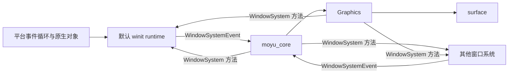

# RFC：窗口系统抽象

- **状态**：提议中
- **日期**：2026-09-06（2026-10-10 修订）
- **作者**：末语项目组
- **适用范围**：`moyu_core`、`moyu`、`moyu_nodes`、`moyu_pal`、默认 winit runtime
- **相关实现**：`crates/core/src/core.rs`、`crates/core/src/surface.rs`、`crates/core/src/core/handle_events.rs`、`crates/core/src/core/pointer_events.rs`、`crates/core/src/core/keyboard_events.rs`、`crates/core/src/core/editable.rs`、`crates/core/src/core/render.rs`、`crates/core/src/core/input.rs`、`crates/core/src/traits/editable_target.rs`、`crates/core/src/plugins/system.rs`、`crates/core/src/base/surface_size.rs`、`crates/nodes/src/nodes/editable.rs`、`crates/moyu/src/entry.rs`
- **相关 RFC**：[Editable 节点与 Input 组件](./2026-07-24-editable-input.md)、[运行时输入注入](./2026-10-02-input-injection.md)、[鼠标按键语义与 DOM 对齐](./2026-10-02-pointer-buttons.md)、[触摸的鼠标兼容事件合成](./2026-10-03-touch-mouse-compatibility.md)

## 摘要

末语把窗口、事件循环和渲染表面的来源从引擎核心移出。`moyu_core` 与 `moyu_nodes` 不再依赖 winit：原始窗口事件由默认 runtime 转换成后端无关的 `WindowSystemEvent` 送入 Core，Core 通过 `WindowSystem` 接口发起窗口控制、光标、IME 与 surface 创建。默认 `moyu` runtime 继续以 winit 实现窗口系统，桌面、Web 和移动端行为与现状一致。

一个 Core 对应一个 surface。窗口系统驱动事件循环、空闲与帧时机，并负责平台特化（窗口创建、Web Canvas 挂载、Android activity）；Core 负责输入处理、命中测试、Editable 路由、插件与渲染协调。第一阶段接口按现有调用形状定义，等第二个窗口系统实现出现后再收敛分组。

系统窗口 command 通过窗口系统能力执行：无法执行时返回错误，不静默报告成功。

## 背景

当前 `moyu_core` 直接依赖 winit，`Core` 持有 `Arc<winit::window::Window>`，`Graphics` 也持有一份，用于创建和重建 `wgpu::Surface`。`winit::WindowEvent` 直接进入 Core，由 `core/handle_events.rs` 分发到 pointer、键盘、触摸、滚轮、焦点、resize、IME 与 redraw 路径；`EditableTarget` trait 直接使用 `winit::KeyEvent`、`winit::Ime` 与 `winit::ModifiersState`，`moyu_nodes` 经 `moyu_core::winit` re-export 使用这些类型。

输入层已经有一部分引擎自己的词汇：`core/input.rs` 定义了 `PointerButton`、`TouchPhase`、`PointerAction`、`KeyInput`、`KeyboardModifiers`，合成输入（调试桥）与窗口事件路径共享 `pointer_press` / `pointer_release` / `pointer_touch` / `pointer_wheel` / `dispatch_keyboard_event`。winit 类型到这些词汇的映射目前留在 Core 内部。

其余与 winit 的耦合分布在四个位置：

- 事件入口与生命周期：`handle_events.rs` 直接接收 `winit::WindowEvent`、`WindowId` 与 `ActiveEventLoop`；
- 窗口控制：`Core` 的 `resize_window`、`set_window_state`、`move_to_center`、光标与全屏操作，以及 `plugins/system.rs` 的窗口 command；
- 平台特化：窗口与 event loop 创建（`surface.rs`）、Windows 图标、Web Canvas 挂载、Android event loop builder；
- 帧调度：`crates/moyu/src/entry.rs` 的 `ApplicationHandler` 实现负责刷新率、redraw 时间与 idle 调度。

这种结构使默认 runtime 简洁，但引擎核心无法在非 winit 环境复用：接入外部程序管理窗口或 Canvas 的环境时，要改的正是上述所有位置。本 RFC 把 winit 收敛到默认 runtime，Core 与节点只使用引擎自己的输入、IME、窗口状态与坐标类型。

## 目标

本文规定：

- `moyu_core` 与 `moyu_nodes` 不依赖、不导出 winit，公开 API 不出现 winit 类型；
- 窗口系统事件协议 `WindowSystemEvent` 与能力接口 `WindowSystem` 的形状；
- 输入词汇（指针、触摸、滚轮、键盘、IME）以及 winit 转换的职责划分；
- Core、Graphics 与 EditableManager 使用 `WindowSystem` 的方式与 surface 生命周期职责；
- 默认 `moyu` runtime 的 `WinitWindowSystem` 与 `WinitApplication` 分工，桌面、Web、移动端行为保持现状；
- `SystemPlugin` 窗口 command 经窗口系统执行、能力缺失时报错的语义；
- 单 Core、单 surface 的范围；
- 现有 winit Rust API 的移除清单；
- `MoyuConfig` 窗口字段对窗口系统的语义。

## 非目标

本文不定义：

- 第二个具体窗口系统实现，及其平台验证与发布策略；
- 同一 Core 驱动多个窗口、多个 surface 或多个输入焦点；
- 多个 Core 共享 `wgpu::Device`、`Queue` 或资源管理器；
- 新平台的文件系统、音频、视频、打包或发布支持；
- 重新设计 JavaScript 可见的 pointer、keyboard、touch、wheel、focus 与 resize 事件；
- Editable 编辑模型的变化（任意位置 caret、selection、软键盘输入策略遵循既有 Editable RFC）；
- 在本 RFC 中拆分新的公开 Cargo crate。

离屏渲染、嵌入式预览与专用输入 bridge 见“后续工作”。

## 术语

**窗口系统**：为一个 Core 提供窗口、输入、事件循环与渲染表面能力的 Rust 组件。它拥有平台事件循环和原生窗口或 Canvas，实现 `WindowSystem`，并把平台事件转换为 `WindowSystemEvent`。默认 winit runtime 是一个窗口系统实现。

**窗口系统事件**：窗口系统提交给 Core 的后端无关事件（`WindowSystemEvent`），涵盖输入、窗口状态、生命周期与帧时机。

**surface**：Graphics 用于输出画面的 `wgpu::Surface`。一个 Core 在任意时刻最多绑定一个，由窗口系统创建、由 Graphics 持有和配置。

## 总体架构



依赖方向固定为：

```text
moyu ──> moyu_core
  │          ▲
  └──> moyu_nodes ──┘
```

- `moyu_core` 定义 `WindowSystem`、`WindowSystemEvent` 与输入、IME、光标、窗口状态类型，实现 Core 与 Graphics；
- `moyu_nodes` 只使用 `moyu_core` 的这些类型；
- `moyu`（默认 runtime）依赖 winit，负责窗口与 event loop 创建、事件转换、surface 提供、启动流程和平台特化；
- `moyu_core` 与 `moyu_nodes` 不依赖、不导出 winit。

Core 在构造时接收 `Arc<dyn WindowSystem>` 并长期持有；Graphics 与 EditableManager 从 Core 获得同一个窗口系统对象。不使用全局注册表，也不在每次调用时临时传入窗口系统对象。

建议位置：

| 内容 | 位置 |
| --- | --- |
| `WindowSystem`、`WindowSystemEvent`、`WindowSystemError`、`ImeEvent` | `crates/core/src/core/window_system.rs`（新增） |
| 输入词汇（`PointerAction`、`KeyInput` 等） | `crates/core/src/core/input.rs`（已有，补充） |
| `WinitWindowSystem`、winit 事件转换、窗口与 surface 创建 | `crates/moyu/src/winit_window_system.rs`（新增） |
| `WinitApplication`（现 `Application`）、启动与帧调度 | `crates/moyu/src/entry.rs` |

首次实现不必严格按此命名，但 winit 相关代码只能落在 `moyu` crate。

## 窗口系统事件

窗口系统把事件循环中的原始事件转换为 `WindowSystemEvent` 后调用 `Core::handle_window_system_event`。Core 不接收 `winit::WindowEvent`、窗口 id、平台句柄或 DOM 事件；一个 Core 只接受来自其窗口系统的单窗口事件。

```rust
pub enum WindowSystemEvent {
    // 指针与滚轮，坐标相对 surface，物理像素
    CursorMoved { physical_x: f64, physical_y: f64 },
    CursorLeft,
    PointerButton { button: PointerButton, pressed: bool },
    Wheel { delta_x: f64, delta_y: f64, mode: WheelEventDeltaMode },
    Touch { identifier: u32, phase: TouchPhase, physical_x: f64, physical_y: f64 },

    // 键盘与文本
    Key { input: KeyInput },
    ModifiersChanged { modifiers: KeyboardModifiers },
    Ime { event: ImeEvent },

    // 窗口状态
    Focused(bool),
    Resized { physical_width: u32, physical_height: u32, scale_factor: f64 },
    ScaleFactorChanged { scale_factor: f64 },

    // 生命周期与时机
    Resumed,
    Suspended,
    CloseRequested,
    Frame,
    Idle,
}
```

事件与现有处理的对应：

| WindowSystemEvent | 现有来源 | Core 处理内容 |
| --- | --- | --- |
| `CursorMoved` / `CursorLeft` | `WindowEvent::CursorMoved` / `CursorLeft` | 换算 client、screen 与 offset 坐标，更新 hover、光标与 `MouseMove` / `MouseEnter` / `MouseLeave` |
| `PointerButton` | `WindowEvent::MouseInput` | `pointer_press` / `pointer_release`，按键配对、click、context menu、双击 |
| `Wheel` | `WindowEvent::MouseWheel` | `pointer_wheel` |
| `Touch` | `WindowEvent::Touch` | `pointer_touch`，tap 判定与鼠标兼容手势 |
| `Key` | `WindowEvent::KeyboardInput` | Editable 路由与全局键盘事件派发 |
| `ModifiersChanged` | `WindowEvent::ModifiersChanged` | 更新 Core 的修饰键状态 |
| `Ime` | `WindowEvent::Ime` | `EditableManager::handle_ime` |
| `Focused` | `WindowEvent::Focused` | 失焦时清除 active editable，派发 Focus / Blur |
| `Resized` | `WindowEvent::Resized` | 暂停与恢复、`resize_stage`、窗口状态更新、Resize / FullScreen 事件 |
| `ScaleFactorChanged` | `WindowEvent::ScaleFactorChanged` | 更新 stage 与 surface 的 scale factor |
| `CloseRequested` | `WindowEvent::CloseRequested` | 派发 `BeforeUnloadEvent` |
| `Frame` | `WindowEvent::RedrawRequested` | 插件 vsync 更新、动画帧事件、Graphics 更新或渲染、VM tick、hover 刷新 |
| `Idle` | `about_to_wait` | Editable 维护、插件 idle 更新 |
| `Resumed` / `Suspended` | `resumed` / `suspended` | 移动端 surface 重建与释放 |

输入语义：

- 指针与触摸坐标相对 surface 左上角，以物理像素提交。Core 用 scale factor、`WindowSystem::window_position()` 与 stage transform 计算现有的 client、screen 与 offset 语义；窗口系统无法提供窗口屏幕位置时返回 `(0, 0)`。
- 手势语义（按下与抬起的最近公共祖先、双击阈值、tap 与鼠标兼容事件、按钮编码）由 Core 保留，窗口系统只做转换；相关内容见输入注入、指针按键与触摸兼容 RFC。
- 键盘事件携带逻辑键、物理 code、键位置、repeat、可输入文本与修饰键快照；平台合成的键盘输入由窗口系统在转换时丢弃。
- 滚轮区分 line 与 pixel 增量。
- IME 的启用、禁用、preedit 与 commit 按 Editable RFC 的生命周期语义传递。

帧时机与生命周期：

- 窗口系统决定空闲更新与可渲染帧的时机，负责刷新率、event loop control flow 与 redraw 调度；Core 不创建 event loop，不设置 control flow，也不假定固定刷新率。
- `Frame` 保留现有的全部工作：非暂停状态下执行 vsync 插件更新、动画帧事件、native 渲染线程唤醒与崩溃检测、web 的 `Graphics::update` / `render`、VM tick 与鼠标 hover 刷新。
- Core 在图形初始化未完成、web 续帧等场景通过 `WindowSystem::request_redraw()` 请求下一帧；请求不保证立即渲染。
- 移动端 `suspended` 发送 `WindowSystemEvent::Suspended`，`resumed` 且 Core 已存在时发送 `WindowSystemEvent::Resumed`；桌面端不发送这两个事件。

## 窗口系统能力

第一阶段使用单一 `WindowSystem` trait，方法对应现有的 `Window` 调用点。trait 实现必须有 `Send + Sync`，Core 与 Graphics 直接调用，不经过队列。

```rust
pub trait WindowSystem: Send + Sync + 'static {
    // 表面与窗口查询
    fn surface_metrics(&self) -> SurfaceMetrics;
    fn window_position(&self) -> (i32, i32);
    fn window_state(&self) -> WindowState;
    fn has_focus(&self) -> bool;

    // 窗口控制
    fn request_redraw(&self);
    fn request_quit(&self);
    fn set_title(&self, title: &str) -> WindowSystemResult<()>;
    fn set_window_state(&self, state: WindowState) -> WindowSystemResult<()>;
    fn request_window_size(&self, logical_width: f64, logical_height: f64) -> WindowSystemResult<()>;
    fn move_to_center(&self) -> WindowSystemResult<()>;
    fn focus_window(&self);
    fn set_cursor(&self, cursor: MoyuCursor);

    // 输入法
    fn set_ime_allowed(&self, allowed: bool) -> WindowSystemResult<()>;
    fn set_ime_cursor_area(&self, x: i32, y: i32, width: u32, height: u32) -> WindowSystemResult<()>;

    // 渲染表面
    fn pre_present_notify(&self);
    fn create_surface(&self, instance: &wgpu::Instance) -> WindowSystemResult<wgpu::Surface<'static>>;
}

pub struct SurfaceMetrics {
    pub physical_width: u32,
    pub physical_height: u32,
    pub scale_factor: f64,
}

pub type WindowSystemResult<T> = Result<T, WindowSystemError>;

pub enum WindowSystemError {
    /// The window system cannot execute this operation at all.
    Unsupported,
    /// The platform call was attempted and failed.
    Platform(anyhow::Error),
}
```

各方法的语义：

- `surface_metrics` 返回当前 surface 的物理尺寸与 scale factor，对应现状的 `window.inner_size()` 与 `window.scale_factor()`；窗口最小化时尺寸为 0，调用方保留现有处理。
- `window_position` 返回窗口左上角在桌面上的物理坐标，用于 pointer 的 screen 坐标与 `getWindowInnerPosition` 命令；平台无法提供时返回 `(0, 0)`。
- `window_state` 查询当前窗口状态（idle / maximized / minimized / fullscreen），供 `Resized` 处理与 `resize_window` 使用。
- `set_window_state` 与 `request_window_size` 由窗口系统实现处理平台补偿：`WinitWindowSystem` 在请求尺寸前后按现有逻辑恢复最小化、最大化与全屏状态，并记住最近一次全屏所在的显示器。
- `request_redraw` 与 `request_quit` 无返回值。前者只表达需求；后者由窗口系统实现决定如何结束会话，默认 `WinitWindowSystem` 把请求投递回事件循环。
- `set_cursor` 接收 `MoyuCursor`（含 `Hidden`），窗口系统实现完成平台光标转换。
- `set_ime_allowed` 与 `set_ime_cursor_area` 在窗口系统不支持 IME 时返回 `Unsupported`，Core 保留普通键盘输入路径。
- `create_surface` 基于给定 `wgpu::Instance` 创建 surface；窗口系统保证创建 surface 的平台对象在其使用期间有效。
- `WindowSystem` 不暴露 event loop、control flow 或计时器实例。

错误处理按用途区分：

- 系统 command 路径（`setTitle`、`setWindowState`、`setWindowSize`、`getWindowInnerPosition`、`getWindowInnerSize`、`quit`）把 `WindowSystemError` 转为 command error 返回 JavaScript；
- 内部路径（FPS 标题、光标、IME 更新、redraw、pre-present）失败时记录日志并继续，不影响剧情、渲染或输入处理；
- `quit` 无法结束整个外部进程时，窗口系统实现结束对应的 Core 会话即可。

## 表面生命周期

一个 Core 只维护一个 surface。职责划分：

- 窗口系统提供 `create_surface`，并保证平台对象（窗口、Canvas、SurfaceView）在 surface 使用期间有效；
- Graphics 负责把 surface 配置为当前尺寸与格式，持有并在渲染中使用它；
- Core 在平台生命周期事件中协调释放与重建。

默认 runtime 与现状一致的流程：

- 初始化：`Graphics::init` 创建 `wgpu::Instance`，调用 `WindowSystem::create_surface`，再选择 adapter、创建 device 与 queue、配置 surface。Android 的 Vulkan → GLES 回退保留在这里：surface 创建或 adapter 选择失败时重建 instance 与 surface 重试。
- 渲染中失效：`get_current_texture` 返回 `Lost` / `Outdated` / `Suboptimal` 时，Graphics 重新配置当前 surface 并跳过该帧；`Timeout` / `Occluded` 只跳过帧。这些分支保持现状。
- 平台回收：Android suspend 时 Core 要求 Graphics 释放 surface，渲染线程确认后进入无 surface 状态并丢弃帧命令；resume 时 Core 重新同步尺寸并要求重建，渲染线程在收到重建命令时调用 `WindowSystem::create_surface`。
- Web：surface 由浏览器管理，渲染完成后请求下一帧。

窗口系统在把 surface 交给 Core 后，不得在未通知的情况下销毁或替换它；平台需要回收时通过 `Suspended` / `Resumed` 事件表达。窗口系统不得把同一个 surface 提供给多个 Core。

## 线程与调用

调用关系与现状一致，不引入主线程代理或请求队列：

- 主线程（事件循环线程）调用全部窗口系统方法，特别是窗口控制与 IME；输入处理与 JavaScript 也在这里；
- native 的 Graphics 更新线程调用 `surface_metrics`、`set_title` 等，渲染线程调用 `create_surface`、`pre_present_notify`；
- `WindowSystem` 实现必须满足 `Send + Sync`，自行处理平台 API 的线程限制。默认 `WinitWindowSystem` 使用 `Arc<winit::window::Window>`，与现状相同；
- 窗口系统实现不得从自己的方法里回调 Core，避免处理事件时重入。

直接调用不意味着操作必然成功：并发安全由 trait bound 保证，能力缺失与平台失败由 `WindowSystemError` 区分。

## Core 与 Graphics

### Core

Core 在现状职责上做以下替换：

- 持有 `Arc<dyn WindowSystem>`，不再持有 `Arc<Window>`；
- 用 `Core::handle_window_system_event(WindowSystemEvent)` 替代 `handle_window_event(&WindowEvent, &WindowId, &ActiveEventLoop)`，用 `WindowSystemEvent::Idle` 替代 `handle_about_to_wait(&ActiveEventLoop)`；
- 窗口操作与查询一律经过 `WindowSystem`，`Core::window()` 删除；
- 修饰键状态从 `winit::keyboard::ModifiersState` 换为 `KeyboardModifiers`。

Core 保留：

- 输入规范化、命中测试、pointer 状态、光标选择、Editable 路由；
- `resize_stage`、stage transform、`surface_size` 与 `window_state` 缓存的协调；
- `resize_window` 的尺寸同步逻辑：桌面端立即按请求值更新 stage、移动端重新同步实际尺寸、Web 忽略请求，与现状 cfg 分支等价；
- `Frame` 与 `Idle` 的处理内容、native 图形线程崩溃检测；
- 系统 command 到窗口系统能力的映射。

Core 不负责：

- 创建 event loop、窗口、Canvas 或 WebView；
- 解析原始平台事件；
- 刷新率、redraw 调度与 control flow；
- 启动状态机、VM wake hook 与 event loop user event，这些属于默认 runtime；
- 持有原生窗口对象或原生 surface handle。

### Graphics

Graphics 在现状职责上做以下替换：

- `Graphics::init` 与 `recreate_surface` 通过 `WindowSystem::create_surface` 获得 surface；
- FPS 标题（`set_title`）、scale factor（`surface_metrics`）、`pre_present_notify` 与 web 续帧的 `request_redraw` 经过 `WindowSystem`；
- surface 的持有、配置、帧获取、命令提交与截图机制不变。

`create_wgpu_surface` 中与窗口无关的部分（backends 选择、adapter 校验、device 创建、格式与 present mode 选择）保留在 Graphics，与窗口有关的部分改为 `WindowSystem::create_surface`。

## 输入、IME 与 Editable

输入词汇沿用 `core/input.rs` 的现有类型，并做两处补充：

- `KeyInput` 增加 `text: Option<String>`（可输入文本），供 Editable 使用；JavaScript 键盘事件不派发该字段，形状不变。
- 新增 `ImeEvent { Enabled, Disabled, Preedit(String), Commit(String) }`。preedit 的光标位置现状未使用，不纳入。

`EditableTarget` 的签名从 winit 类型改为引擎类型：

```rust
pub trait EditableTarget: Node {
    fn is_disabled(&self) -> bool;
    fn is_read_only(&self) -> bool;
    fn did_focus(&mut self);
    fn did_blur(&mut self);
    fn handle_keyboard_input(&mut self, input: &KeyInput);
    fn handle_ime(&mut self, event: &ImeEvent);
    fn settle_pending_clear(&mut self);
    fn cancel_composition(&mut self);
    fn ime_cursor_rect(&self) -> Option<Rect>;
}
```

`Editable` 节点的判定改用引擎词汇：退格键为 `key == "Backspace"`，空格为 `key == " "`，字符输入取 `text`，控制键过滤使用 `KeyboardModifiers` 字段。IME 处理映射 `Preedit` / `Commit`；`Enabled` / `Disabled` 仍只用于候选窗更新。

`EditableManager` 持有 `Arc<dyn WindowSystem>`，不再持有窗口：`desired_ime_target` 用 `WindowSystem::has_focus()`，启用与候选窗更新调 `WindowSystem::set_ime_allowed` 与 `WindowSystem::set_ime_cursor_area`。候选窗坐标换算保持现状：editable 局部 caret、节点变换、stage 缩放与 surface scale factor，最终以物理坐标提交。

窗口失焦由 `WindowSystemEvent::Focused(false)` 提交：Core 先清除 active editable，再派发全局 blur 事件；恢复焦点不自动恢复 editable 焦点。

从 Core 移入默认 runtime 的转换逻辑，语义逐条保持：

| 内容 | 现状位置 | 说明 |
| --- | --- | --- |
| 鼠标按键映射 | `pointer_events.rs` `from_winit_button` | DOM 定义的五个按钮，其余物理键忽略 |
| 触摸相位映射 | `pointer_events.rs` | Started / Moved / Ended / Cancelled |
| 滚轮 delta 与 mode | `pointer_events.rs` | LineDelta / PixelDelta |
| 键盘 key 与 code 格式化 | `keyboard_events.rs` | Named 键取调试名，Space 转为 `" "`，Character 取字符串，Unidentified 与 Dead 按现状处理并记录日志 |
| 键位置映射 | `keyboard_events.rs` | Standard / Left / Right / Numpad |
| 修饰键快照 | `keyboard_events.rs` | Control / Shift / Alt / Super → `KeyboardModifiers` |
| synthetic 键盘过滤 | `keyboard_events.rs` | 平台合成事件不进入 Core |
| Android 返回键 | `keyboard_events.rs` | 转换为 `WindowSystemEvent::CloseRequested`，Core 统一派发 `BeforeUnloadEvent`，行为与现状一致 |
| IME 事件映射 | `handle_events.rs` | Preedit / Commit / Enabled / Disabled |

## 系统 commands 与能力缺失

`SystemPlugin` 的窗口 command 经窗口系统执行：

| command | 执行路径 |
| --- | --- |
| `setWindowSize` | `Core::resize_window` → `WindowSystem::request_window_size` 与尺寸同步；随后 `move_to_center`（现状行为） |
| `setWindowState` | `Core::set_window_state` → `WindowSystem::set_window_state`，并更新状态缓存 |
| `setTitle` | `WindowSystem::set_title` |
| `getWindowState` | Core 的状态缓存 |
| `getWindowInnerPosition` | `WindowSystem::window_position` 换算为逻辑坐标，返回 `{ x, y }` |
| `getWindowInnerSize` | `WindowSystem::surface_metrics` 换算为逻辑尺寸，返回 `{ width, height }` |
| `quit` | `WindowSystem::request_quit` |

- 窗口系统无法执行时返回 command error，不静默成功，也不返回伪造值；查询在窗口系统无法提供数据时同样返回错误。
- 默认 runtime 保留现有平台语义：Web 与移动端忽略尺寸请求、Web 全屏使用浏览器 FullScreen API；这些平台行为不返回错误。
- `getStageSize`、`getPlatform`、快照、文件访问、参数读取与引擎内部状态不依赖窗口系统能力，语义不变。
- `getWindowInnerPosition` / `getWindowInnerSize` 的 JavaScript 返回形状与现状一致；实现从 winit DPI 类型改为引擎自己的 `{ x, y }` / `{ width, height }`，不再需要 winit 的 serde feature。

## 默认 winit runtime

默认 `moyu` runtime 是唯一依赖 winit 的部分，拆成两个组件。

**WinitWindowSystem**（新增）实现 `WindowSystem`：

- 持有 `Arc<winit::window::Window>` 与 `EventLoopProxy`；
- 提供 surface 创建、窗口控制、光标、IME 与查询能力；
- 提供平台特化：窗口创建（应用 `MoyuConfig`、Windows 图标、Web Canvas 挂载、Android event loop builder 与 activity）、全屏显示器记忆；
- 提供 winit 事件到 `WindowSystemEvent` 的转换函数，包含键盘格式化与鼠标按键映射。

**WinitApplication**（现 `Application`）继续实现 `winit::application::ApplicationHandler`：

- 持有窗口、`WinitWindowSystem`、event loop proxy、启动状态、刷新率与下一次 redraw 时间；
- 创建窗口与 Core，装配窗口系统，维持启动流程（图形初始化、节点与 renderer 注册、插件装配、运行时加载、splash 与 ready 事件）；
- 把 winit 生命周期、窗口、输入与 IME 事件转换为 `WindowSystemEvent` 并调用 `Core::handle_window_system_event`；
- 维持刷新率、redraw 调度、`ControlFlow`、VM wake hook 与 quit 请求的接收；
- web 与 Android 入口（`moyu_init`、`android_main`）继续使用这里的 event loop 创建路径。

现有回调映射保持：

| winit 回调 | WinitApplication 职责 | Core 入口 |
| --- | --- | --- |
| `resumed` | 首次创建窗口与 Core；已有 Core 时移动端重建 surface | `WindowSystemEvent::Resumed`（移动端） |
| `suspended` | 清理调度状态；移动端等待 surface 释放完成 | `WindowSystemEvent::Suspended`（移动端） |
| `about_to_wait` | 调用 idle；设置 `ControlFlow::Wait` / `WaitUntil` | `WindowSystemEvent::Idle` |
| `new_events` | 到达下一帧时间时请求 redraw | 无，WinitApplication 调度 |
| `window_event` | 转换输入与窗口事件；redraw 为帧 | 对应 `WindowSystemEvent` |
| `user_event` | VM wake、启动阶段推进、quit 请求 | 无，runtime 内部 |

Core 不持有 event loop、proxy、control flow、刷新率状态或启动状态机；`ApplicationInitEvent` 是 `WinitApplication` 的内部细节，不属于 `WindowSystemEvent` 或 `moyu_core` 的公开 API。

首轮不抽取通用 Application 或通用 event loop runner；第二个窗口系统实现出现后再决定是否提取可复用的会话组件。

## 项目配置

`MoyuConfig` 的 `windowTitle`、`windowState`、`windowResizable` 与 `initialSurfaceSize` 是给窗口系统的建议：

- 默认 runtime 按现状应用；
- 其他窗口系统实现在自身创建模型允许时映射，无法表达时可以在启动阶段忽略；
- 启动时忽略建议不代表运行期 command 可以静默成功；
- `stageSize`、渲染后端、呈现模式等配置由 Core 与 Graphics 消费，语义不变。

## Rust API 变更

开发阶段直接移除以下 API，不保留兼容期。

**删除**

- `moyu_core::winit` re-export（`lib.rs`）；
- `Core::window()`；
- `moyu_core::surface` 模块：`create_eventloop`、`create_window`、`create_wgpu_surface`；
- `Core::set_fullscreen_with_monitor`、`Core::fullscreen`、`Core::maximized`、`Core::minimized`、`Core::idle`（迁移前已无调用者）；
- `crates/core` 与 `crates/nodes` 的 winit 依赖。

**签名变化**

- `Core::new(Arc<Window>)` → `Core::new(Arc<dyn WindowSystem>)`；
- `Core::handle_window_event` → `Core::handle_window_system_event(WindowSystemEvent)`；
- `Core::handle_about_to_wait` 并入 `WindowSystemEvent::Idle`；
- `EditableTarget::handle_keyboard_input(&KeyEvent, ModifiersState)` → `(&KeyInput)`；`handle_ime(&Ime)` → `(&ImeEvent)`；
- `SurfaceSize::from_physical_size(&PhysicalSize<u32>, f64)` → `(width: u32, height: u32, scale_factor: f64)`。

**保持**

JavaScript 事件、系统 command 名称与返回形状、Kit API 不变；`moyu` 继续依赖 winit，需要 winit 特有能力的调用方依赖默认 runtime。

## 错误与边界行为

- 窗口系统不支持窗口位置、状态、标题、尺寸控制或 IME：对应能力返回 `Unsupported`，由系统 command 触发时转为 command error；内部路径记录日志并继续。
- surface 创建失败：初始化阶段按现状处理（记录并退出或报告错误）；重建失败时保留无 surface 状态并记录日志，等待下次重建。
- `Lost` / `Outdated`：Graphics 重新配置当前 surface 并跳过该帧。
- suspend 期间：Core 不请求或提交帧，直到重建完成。
- 窗口系统未实现 IME：普通键盘输入与 Editable 编辑仍可用。
- 窗口系统结束会话：先释放 surface，再释放 Core 与窗口系统对象。

## 性能

输入与渲染热路径的成本模型不变：

- 每个平台事件只做一次转换，以值类型进入 Core；不引入 JSON 或事件对象树；
- `DispatchRecord` 等已有的按需记录机制保留，窗口事件路径保持零分配；
- 窗口系统调用只出现在状态变化、系统 command、IME 更新与明确的帧请求处，不进入节点遍历或绘制命令收集；
- 单 surface 模型不引入额外的资源同步。

## 实施顺序

建议按以下顺序实施，前一步完成后再进入下一步：

1. **类型与词汇**（`moyu_core`、`moyu_nodes`）：定义 `WindowSystem`、`WindowSystemEvent`、`WindowSystemError` 与 `ImeEvent`，扩充 `KeyInput.text`；把 `modifiers_state` 与 `EditableTarget` 切换到引擎类型，`Editable` 节点完成适配。此时 winit 映射仍在 Core 内，行为不变。
2. **默认 runtime 窗口系统**（`moyu`）：实现 `WinitWindowSystem` 与事件转换函数；`Application` 改为 `WinitApplication`，自持窗口，构建窗口系统对象。
3. **核心切换**（`moyu_core`）：`Core`、`Graphics`、`EditableManager` 改为使用 `WindowSystem`；事件入口切换为 `handle_window_system_event`；`Graphics` 的 surface 创建改走窗口系统。
4. **清理**：删除 `surface.rs`、`moyu_core::winit` re-export、`Core::window()` 与无调用者的 API；移除 `crates/core`、`crates/nodes` 的 winit 依赖。
5. **验收**：依赖树、构建与行为回归。

迁移时逐项对照现状，不重写语义：

- 事件分发从 `if !handled` 链改为 `WindowSystemEvent` match，各分支处理内容不变；
- `resize_window`、`Frame`、suspend/resume 的 cfg 分支按现状搬运，平台差异要么进窗口系统实现，要么保留在 Core 的既有分支；
- 按键与按钮映射按“从 Core 移入默认 runtime 的转换逻辑”表逐条核对；
- `plugins/system.rs` 的返回形状按现状核对。

## 测试与验收

自动检查：

```bash
cargo build
```

依赖验收（本 RFC 的核心目标，两条命令都必须无输出）：

```bash
cargo tree -p moyu_core -i winit
cargo tree -p moyu_nodes -i winit
```

预期 bindings 无变化；若 `yarn generate:bindings` 产生 diff，需确认是预期内的类型变化。

默认 runtime 的行为回归：

1. 桌面窗口：创建、显示、标题、尺寸与状态、光标、关闭请求；
2. 输入：鼠标、触摸、滚轮、键盘、修饰键、全局 JavaScript 事件与手势语义；
3. IME：preedit、commit、焦点切换、候选窗位置；
4. surface：resize、scale factor 变化、最小化与恢复、suspend / resume 重建；
5. 调度：刷新率与 redraw、VM wake、插件 idle 与 vsync 更新、FPS 标题；
6. Web：Canvas 挂载、尺寸变化、续帧；
7. Android：activity、surface 释放与恢复；
8. 系统 command：正常路径与不支持时的错误路径。

调试桥的注入与截图（`debug_mouse`、`debug_touch`、`debug_key`、`debug_screenshot`）在迁移后仍可用。

第二个窗口系统实现不作为验收前提；它的验证要求（不依赖 winit 类型、surface 生命周期、输入协议覆盖）由对应的设计文档提出。

## 被否决的方案

**继续让 Core 持有 winit Window**。即使在入口层包装，Core、Graphics 与 Editable 仍绑定 winit 类型，无法在非 winit 环境复用。

**只替换 Window 字段，仍向 Core 传递 winit 事件**。依赖从字段移到方法签名，输入与 Editable 依旧无法脱离 winit。

**由 Core 创建 event loop 与窗口**。Core 需要同时适配 winit、浏览器、移动端与外部 GUI 框架的事件循环；窗口系统驱动生命周期、Core 处理规范化事件是清晰的分工。

**由 Core 根据 raw window handle 创建 surface**。handle 的来源、线程规则与生命周期属于窗口系统。窗口系统提供 surface，Graphics 专注 WGPU 配置与渲染。

**全局窗口系统注册表或异步请求队列**。全局对象让所有权与生命周期不明确；请求队列为窗口、光标、IME 等同步操作引入额外的排队、确认与销毁顺序。Core 直接持有并调用窗口系统对象，跨线程由实现自行处理。

**首轮支持多窗口**。多窗口需要为每个 surface 分别维护尺寸、输入焦点、IME 与渲染资源策略，显著扩大接口与验证范围。首轮固定单 Core 单 surface。

## 后续工作

- 第二个窗口系统实现，及其能力范围与错误语义的验证；
- 多窗口、多 surface 与多视图渲染模型；
- 离屏 surface 与无窗口运行模型；
- 窗口系统能力的可查询描述或特性发现接口；
- 将 `WindowSystem` 与默认 winit runtime 拆分为独立 crate 的条件；
- Web 软键盘与 hidden textarea 等专用输入 bridge；
- 窗口系统协议的自动化测试工具（事件录制与回放）。

## 结论

- winit 收敛到默认 runtime；`moyu_core` 与 `moyu_nodes` 不依赖、不导出 winit；
- 窗口系统通过 `WindowSystemEvent` 提交规范化事件，通过 `WindowSystem` 提供窗口、光标、IME 与 surface 能力；
- 输入词汇沿用已有的 `PointerAction` / `KeyInput` 等类型，补充文本与 IME 事件；
- Graphics 保留 WGPU 初始化与渲染，surface 由窗口系统创建；
- 一个 Core 对应一个 surface；
- 默认 runtime 行为保持不变，系统 command 在能力缺失时报错；
- 旧 winit API 直接移除，不保留兼容层。

后续窗口系统实现遵循这些边界，或以新的 RFC 替代。
