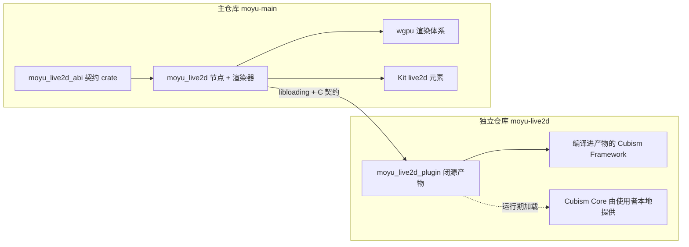

# RFC：Live2D 支持与插件隔离架构

- **状态**：已接受
- **日期**：2026-10-13
- **作者**：末语项目组
- **适用范围**：`moyu_live2d`（宿主接入）、`moyu_live2d_abi`（契约）、`moyu_live2d_plugin`（独立仓库产物）、`@momoyu-ink/kit`
- **相关实现**：待实现（`crates/live2d/`、`crates/live2d-abi/`；独立仓库 `moyu-live2d`）
- **相关 RFC**：[基础节点系统](./2026-07-20-node-system.md)、[Steam 桌面端集成](./2026-07-22-steam-integration.md)

## 摘要

末语通过两层结构接入 Live2D：

1. `moyu_live2d_plugin`（独立仓库、闭源产物）内部使用 Cubism Native Framework 与运行期加载的 Cubism Core，把模型语义、动作、物理与遮罩布局计算全部封装在插件内，对外暴露一组自制 C 契约。
2. `moyu_live2d`（本仓库 `crates/live2d`）用 `libloading` 加载插件，提供独立的 `live2d` 节点，接收后端无关的绘制数据，并由 wgpu 完成全部渲染。

SDK 内容只存在于插件产物中：本仓库与引擎发行物不包含任何 Cubism 源码或二进制；Core 由使用者在本地提供，插件在运行期加载。插件不接触任何图形 API，输出纯 CPU 求值结果。

首版支持 Windows、Linux、macOS、Android；Web 不提供插件实现，节点保持不可用并给出明确状态。

## 背景

Live2D 是视觉小说角色的主流表现形态。接入它需要同时满足以下约束：

- 模型数据（moc3）只能由官方专有运行时（Cubism Core）解析与求值，引擎无法自行读取；
- 官方语义层（Framework）是 C++ 实现，引擎主仓库是 Rust/MPL-2.0，SDK 内容必须与主仓库严格分离；
- 引擎已有 wgpu 渲染体系（节点、渲染器、离屏 pass、资源系统），不希望引入第二套图形 API；
- 引擎已有外部二进制加载与降级先例：视频解码库（`libloading` + 自制 C ABI + 缺失降级）与 Steam（动态库、初始化失败降级）；
- 剧本侧需要动作、表情、参数控制与存档回放能力，时间轴必须由引擎掌控。

因此 Live2D 不能实现为主仓库内的普通 crate（会引入 SDK 内容），也不适合由插件自行绘制（会引入跨图形 API 互操作）。插件负责“把模型算出来”，引擎负责“把结果画出来”。

## 先例调研

接入 Live2D 的公开实现主要有两类，均已在源码层核实：

**Ren'Py**（`renpy/gl2/` 目录，合计约 156KB）：

- Core 以运行期动态加载接入（Windows `Live2DCubismCore.dll`、macOS `.dylib`、其他 `libLive2DCubismCore.so`），按符号名取函数，未使用头文件链接；
- 语义层完全自研：motion3 求值（含两版贝塞尔实现）、摆锤物理引擎、表达式混合、alias/seamless 语义均为自写，未移植 Framework；
- 遮罩使用简化方案：单张遮罩纹理，采样坐标由顶点位置与模型尺寸推导，随引擎 mesh 管线绘制；
- Web 平台使用独立的 Live2D WASM 实例，通过 C shim 在两个 WASM 堆之间拷贝数据；
- 提供 `has_live2d()` 检测，初始化失败时游戏可降级运行。

**GDCubism**（Godot 扩展，第三方）：

- Framework 源码与 Core 静态库在构建期全部编译进单个扩展二进制；
- 语义层使用官方 Framework，渲染器替换为自定义 `CubismRenderer` 子类，绘制走 Godot RenderingServer；
- 仓库内无 SDK 内容，构建时要求使用者自备 SDK 目录；
- 支持桌面三平台与移动端（实验性），无 Web。

| 决策点 | Ren'Py | GDCubism | 末语选择 |
| --- | --- | --- | --- |
| Core 接入 | 运行期动态加载 | 构建期静态链接 | 运行期加载（沿用 Ren'Py 路线，契合引擎既有模式） |
| 语义层 | 自研子集 | 官方 Framework | 官方 Framework（保真度优先） |
| 渲染 | 引擎自绘 | 引擎自绘（自定义 Renderer） | 引擎自绘（wgpu，绘制数据由插件输出） |
| SDK 内容位置 | 仓库外 | 仓库外 | 仓库外，仅存在于插件产物 |
| 降级 | `has_live2d()` | 无 | 节点不可用状态 + 事件（与 video 节点一致） |

结论：语义层用 Framework、Core 运行期加载、渲染由引擎完成，这三者组合即本 RFC 的架构，同时重演了引擎视频解码库的既有模式（自制 C ABI + 运行期加载 + 缺失降级）。

## 目标

- 定义双层架构（插件 / 宿主）的职责边界与 SDK 内容隔离规则；
- 定义插件与宿主之间的 C 契约：版本协商、导出函数、绘制数据、遮罩命令、文件访问、贴图上报、错误与内存约定；
- 定义 `live2d` 节点的属性、命令与事件的设计基线；
- 定义宿主 wgpu 渲染器的绘制语义（遮罩执行、混合与颜色、采样）；
- 定义平台矩阵与降级行为。

## 非目标

- 实现计划、任务分解与验收排期（由迭代文档另行承载）；
- Web 平台实现（契约保留可 WASM 化空间，实现后置）；
- 5.3 全量颜色混合（16 色 × 5 α）与 offscreen 渲染树（首版检测并降级，升级口保留）；
- 高精度遮罩模式与读写目的纹理的合成管线；
- pose3 / userdata3 / cdi3 的特化支持（pose3 仅提供总开关，不暴露参数级 API；其余按 Framework 默认行为运行）；
- 动作内嵌声音的自动播放（仅元数据上报声音路径，播放由项目代码通过 audio 插件命令自行决定）；
- 口型同步（首版不做；需要引擎音频振幅到插件的喂值通道）；
- 插件内部状态的存档序列化（读档由项目重建节点并重放命令与参数）；
- SDK 的获取、分发与项目内放置流程的工具化（独立议题）。

## 术语

| 术语 | 含义 |
| --- | --- |
| Core | Live2D Cubism Core，官方专有运行时，解析 moc3 并求值模型，纯 CPU |
| Framework | Live2D Cubism Native Framework，官方 C++ 语义层（动作、物理、效果） |
| 插件 | `moyu_live2d_plugin`，独立仓库的闭源产物，内含编译后的 Framework |
| 宿主 / 引擎 | 末语引擎，本 RFC 中指 `crates/live2d` 及其上层 |
| 契约 | `moyu_live2d_abi`，`repr(C)` 类型与版本常量的唯一定义来源 |
| 绘制数据 | 插件输出的后端无关快照：逐 drawable 的顶点、UV、索引、混合、遮罩参数与遮罩命令 |
| 遮罩命令 | 插件计算好的“如何绘制遮罩缓冲”的指令序列，宿主只负责执行 |
| drawable | moc3 模型的绘制单元，Core 以数组形式暴露其全部状态 |

## 总体架构

各层职责：

1. **`moyu_live2d_plugin`**（独立仓库、闭源）：
   - 用 `libloading` 加载 Core；
   - 编译官方 Framework（源码编译进插件产物，见“插件侧实现要点”）；
   - 持有模型生命周期：moc3 解析、参数求值、动作/表情队列（含自动待机调度）、物理与效果更新（眼眨、呼吸、目光跟随，均由节点选项控制）、遮罩布局计算；
   - 输出绘制数据快照与遮罩命令；
   - 不接触图形 API，不创建任何 GPU 资源，不读文件（文件字节由宿主回调提供）。
2. **`moyu_live2d_abi`**（本仓库内独立小 crate）：`repr(C)` 类型、版本常量、错误码的唯一定义来源；插件与该 crate 共用同一份定义（path/git 依赖）。
3. **`moyu_live2d`**（本仓库 `crates/live2d`）：
   - `libloading` 加载插件并做版本协商；
   - 提供 `live2d` 节点（属性、命令、事件）与 wgpu 渲染器；
   - 接管贴图加载（走引擎资源系统）、画布到布局的坐标映射、遮罩缓冲与绘制；
   - 插件缺失或 Core 缺失时节点保持不可用状态。
4. **Kit**：`<live2d>` intrinsic element 的 TS 声明与类型。

## 隔离边界

**SDK 内容归属**

- 本仓库（源码、构建产物）与引擎发行物不含任何 Cubism 源码或二进制；
- 插件产物内含编译后的 Framework；Core 由使用者在本地提供、插件运行期加载，Core 不进入插件产物；
- 引擎仓库/发行物可做特征串自检（`Live2DCubism`、`csm*` 符号等零命中）作为边界验证手段。

**插件侧实现要点**

- 编译集合：Framework 的 `src` 根文件与 `Effect/Id/Math/Model/Motion/Physics/Rendering/Type/Utils` 各目录，含 `Rendering` 的共享文件（`CubismRenderer` 基类等）；不含任何图形后端子目录（D3D/OpenGL/Metal/Vulkan 均不编译）。另需插件自带 `CubismRenderer::Create` 与 `CubismRenderer::StaticRelease` 的定义——二者由官方图形后端提供、共享文件未定义，缺失将导致链接失败；`Create` 不会被调用（提供空实现并注明禁止使用），`StaticRelease` 供 Framework 清理调用；
- Core 引用方式：Framework 以 `Core::csmXxx()` 形式调用 Core，属链接期符号。插件在 Rust 侧提供一层 `csm*` 转发符号（`#[no_mangle] extern "C"`），把全部被引用的 Core 符号转发到 `libloading` 得到的函数指针；漏配符号会在链接期暴露（前提：链接配置将未解析符号视为错误），不会静默失败；
- Core 查找顺序：插件初始化参数中的显式路径 → 插件同目录 → 宿主可执行文件同目录 → 系统搜索路径；平台文件名与官方一致（`Live2DCubismCore.dll` / `libLive2DCubismCore.dylib` / `libLive2DCubismCore.so`）；
- 插件对宿主暴露稳定 C 契约，不泄漏 C++ 类型；边界处不 panic、不抛异常，统一转错误码。

**宿主侧要点**

- 宿主只依赖 `moyu_live2d_abi`，不感知 Framework/Core 的存在；
- 贴图、文件、时间、资源回收均由宿主负责；
- 插件上下文按进程级单例使用：Framework 全局仅初始化一次，宿主以单一句柄服务全部节点（各节点持有独立模型），Core 在插件销毁前不卸载。

## 平台矩阵

| 平台 | 插件形态 | 说明 |
| --- | --- | --- |
| Windows | `moyu_live2d_plugin.dll` | Core 由插件运行期加载 |
| Linux | `libmoyu_live2d_plugin.so` | 同上 |
| macOS | `libmoyu_live2d_plugin.dylib` | 同上 |
| Android | `libmoyu_live2d_plugin.so` | 同上 |
| Web | 无插件实现 | 节点不可用；契约保留可 WASM 化空间，实现后置 |

## C 契约

契约定义在 `moyu_live2d_abi`，本节为设计基线；字段与签名以实现评审为准，但语义边界不得收紧。

### 版本与协商

- `moyu_live2d_plugin_abi_version() -> u32`：编码为 `major << 16 | minor`；
- 宿主只加载主版本一致的插件；宿主与插件须由同一 `moyu_live2d_abi` 版本构建，结构体演进仅允许在尾部追加字段（不承诺跨版本二进制兼容）；
- 提供保留的能力位 `moyu_live2d_plugin_caps() -> u64`，首版固定值，供后续能力检测扩展。

### 导出函数

| 函数 | 用途 |
| --- | --- |
| `..._plugin_create(init, out_handle) -> i32` | 初始化插件：接收文件访问回调与可选 Core 路径 |
| `..._plugin_destroy(handle) -> i32` | 释放插件 |
| `..._plugin_last_error() -> span` | 读取初始化/协商阶段的错误消息（无句柄时使用） |
| `..._load_model(handle, desc, out_model) -> i32` | 加载模型：宿主提供 model3.json 路径与字节访问入口 |
| `..._unload_model(handle, model) -> i32` | 卸载模型 |
| `..._update(handle, model, delta_seconds) -> i32` | 推进一帧求值；快照经 `..._get_frame` 获取 |
| `..._get_frame(handle, model, out_frame) -> i32` | 取当前快照（`FrameDesc`；有效至下次 `update` 或卸载） |
| `..._start_motion(handle, model, group, index, priority, fade_in, fade_out, loop) -> i32` | 播放动作（priority：None=0 / Idle=1 / Normal=2 / Force=3，缺省 Normal；fade 单位秒，缺省采用 model3.json 条目配置；`loop` 为真时循环播放） |
| `..._stop_all_motions(handle, model) -> i32` | 停止全部动作 |
| `..._set_expression(handle, model, name) -> i32` | 切换排他表情 |
| `..._stop_expression(handle, model) -> i32` | 停止当前排他表情，回到无表情状态 |
| `..._set_parameters(handle, model, pairs, count) -> i32` | 批量设置参数覆盖值 |
| `..._reset_parameters(handle, model) -> i32` | 清除参数覆盖 |
| `..._set_options(handle, model, flags) -> i32` | 设置模型选项位（位 0 物理、位 1 姿态、位 2 眼眨、位 3 呼吸、位 4 目光跟随、位 5 自动待机；默认位 0–3、位 5 开启，位 4 关闭；props 变更时下发） |
| `..._set_look_target(handle, model, x, y) -> i32` | 设置注视目标（归一化 -1..1；`look` 启用时随指针移动下发，指针离开时回中心） |
| `..._set_part_opacity(handle, model, id, value) -> i32` | 设置部件不透明度 |
| `..._hit_test(handle, model, area, x, y, out_hit) -> i32` | 命中测试；结果经 `out_hit` 输出（1 命中 / 0 未命中）；x/y 为节点局部画布像素坐标（左上原点、y 向下，由宿主从事件坐标换算） |
| `..._query_canvas(handle, model, out) -> i32` | 画布信息：尺寸、原点、`pixelsPerUnit` |
| `..._query_motions(handle, model, out) -> i32` | 动作清单：组名、序号、时长、淡入淡出、可选声音文件路径 |
| `..._query_expressions(handle, model, out) -> i32` | 表情清单：名称、淡入淡出 |
| `..._query_hit_areas(handle, model, out) -> i32` | 命中区域清单：名称 |
| `..._query_parameters(handle, model, out) -> i32` | 参数清单：ID、类型、最小/最大/默认值 |
| `..._query_textures(handle, model, out) -> i32` | 贴图清单：相对资产根的路径 |
| `..._query_parts(handle, model, out) -> i32` | 部件清单：ID |
| `..._poll_event(handle, model, out_event) -> i32` | 拉取待交付事件（动作结束/动作事件等；无事件时返回空标记） |
| `..._last_error(handle) -> span` | 读取最近一次调用失败的 UTF-8 错误消息（有效至下次调用） |

列表类查询采用两段式语义：先取条目数量，再按索引读取条目描述；返回值有效至模型卸载。事件为拉取式队列：宿主在每次 `update` 后轮询；事件载荷中的字符串有效至下一次调用。

所有调用均在引擎主线程进行，插件无需线程安全。

### 文件访问与贴图上报

- 宿主在 `create` 时提供 `read_file(user_data, path, offset, buffer, inout_len)` 回调，两段式语义：`buffer` 为空时返回所需大小，否则拷贝数据。回调在主线程同步执行；`path` 一律为相对资产根（`assets/`）的路径，插件负责把 model3.json 内的引用解析为资产根相对路径后传入。宿主字节有效至回调返回，插件在回调内完成拷贝，自行负责 moc3 所需的 64 字节对齐分配；
- 模型加载后，贴图清单经 `..._query_textures` 取得（路径相对资产根）；宿主用引擎资源系统异步加载贴图并按索引绑定，插件不接触贴图字节以外的任何资源状态。

### 模型元数据查询

加载完成后可查询，返回值有效至模型卸载：

- 画布信息：尺寸、原点、`pixelsPerUnit`；
- 参数列表：ID、类型、最小/最大/默认值；
- 动作清单：组名、每组条目数、每条目的时长与淡入淡出时间、可选声音文件路径（相对模型目录）；
- 表情清单：名称与淡入淡出时间；
- 命中区域清单：名称；
- 部件清单：ID。

### 更新与快照

- 宿主每帧调用 `update(delta_seconds)`；是否更新、以何速率更新由引擎决定，插件没有内部时钟；
- 快照（绘制数据与遮罩命令）为插件持有，**有效至下一次 `update`（或卸载）**；宿主不得跨帧持有；
- 快照为指针化视图，宿主按需读取，插件不要求宿主拷贝；
- 单帧求值顺序（插件内部固定，与 5-r.5 `CubismUpdateScheduler` 的优先级一致）：载入参数 → 动作（队列空时按待机开关自动播放；随后保存状态作为下帧基准）→ 眼眨 → 表情 → 目光跟随 → 呼吸 → 物理 → 姿态 → 参数覆盖与部件不透明度覆盖 → Core 更新（`csmUpdateModel`）；参数覆盖在效果链之后应用，直至 `resetParameters`；`setPartOpacity` 同为持续覆盖。

### 绘制数据

坐标约定：顶点为**画布像素空间**（左上原点、y 向下），画布范围由画布信息给出；宿主负责画布矩形到节点布局矩形的映射。UV 为归一化坐标（左上原点、y 向下），插件已完成底层翻转归一。

`FrameDesc`（每帧快照根）：

| 字段 | 说明 |
| --- | --- |
| `canvas_size` / `canvas_origin` / `pixels_per_unit` | 画布信息（每帧携带，允许模型切换后变化）；宿主侧的画布尺寸另有 `ready` 元数据来源，快照中这三项保留供需要逐帧几何的消费者使用 |
| `drawables` / `drawable_count` | 逐 drawable 快照数组，已按绘制顺序排列 |
| `mask_buffers` / `mask_buffer_count` | 遮罩缓冲清单（尺寸），数量与尺寸由插件计算 |
| `mask_commands` / `mask_command_count` | 遮罩绘制命令序列 |
| `mask_buffer_count == 0` | 该模型本帧无需遮罩 |

逐 drawable 字段：

| 字段 | 说明 |
| --- | --- |
| `flags` | 位域：可见、双面、遮罩反相、混合模式不受支持（检测结果） |
| `blend_mode` | 插件已定下的有效混合模式（`BLEND_NORMAL` / `BLEND_ADD` / `BLEND_MULTIPLY`），窄集之外的模式已降级为 Normal |
| `source_blend_mode` | 模型自身声明的混合模式，宿主不解释、仅用于 `blendModeUnsupported` 事件诊断 |
| `texture_index` | 贴图清单索引 |
| `opacity` | drawable 不透明度（模型级不透明度已由插件合并于此，宿主只应用一次） |
| `multiply` / `screen` | 颜色校正参数（RGB 乘算/加算），逐 drawable 生效 |
| `vertex_count` / `index_count` | 顶点数与索引数（索引为 u16） |
| `vertices` / `uv` / `indices` | 顶点、UV、索引指针（插件持有） |
| `mask_buffer_index` | 使用的遮罩缓冲（无遮罩为 -1） |
| `mask_channel` | 遮罩通道索引（0–3） |
| `clip_matrix` | 采样遮罩用的变换矩阵（行主序 4×4；输入为快照顶点空间，输出为遮罩纹理采样 UV） |

### 遮罩命令

遮罩语义（分组去重、包围盒、通道打包、矩阵计算）全部由插件计算，宿主只执行：

| 字段 | 说明 |
| --- | --- |
| `buffer_index` | 目标遮罩缓冲 |
| `channel` | 写入通道（0–3） |
| `drawable_index` | 提供几何与贴图的 drawable（引用快照数组索引，插件已完成重映射） |
| `matrix` | 遮罩绘制矩阵（行主序 4×4；输入为快照顶点空间，输出为遮罩裁剪空间，该空间 y = +1 落在遮罩缓冲首行，与采样 UV 的 v = 0 一致） |
| `clip_rect` | 裁剪空间矩形（与 `matrix` 同一空间的 xmin/ymin/xmax/ymax），片元在矩形外不写入掩码 |

执行规则（宿主实现固定）：每个遮罩缓冲在本帧开始时先清空到 1.0，之后才执行它的命令（清除时点固定，因此命令本身不再携带清除标志）；以“再乘以（1 − 源色）”的累积方式绘制，源色 = 贴图 alpha × 通道 one-hot × 区域内判定（区域外为 0），累积结果中 0 表示被遮罩覆盖、1 表示未覆盖；绘制 drawable 时，普通遮罩系数 = 1 − T、反相遮罩系数 = T（T 为 `mask_channel` 对应通道的采样值）。遮罩组数超过单缓冲容量时，插件须分配额外缓冲保证布局有效，不得使用“整缓冲随用随清”的兜底布局。

### 错误与内存约定

- 全部函数返回 `i32` 错误码：0 成功；非 0 分类错误（参数、版本、Core 不可用、文件、解析、不支持、内部）；
- 生成错误时可读 `..._last_error(handle)` 获取 UTF-8 消息（span 形式，有效至下次调用）；
- 字符串一律 UTF-8 span（指针 + 长度），不要求 NUL 终止；
- 插件持有的全部内存由插件释放；宿主不释放任何插件指针；
- 回调期间宿主不得重入插件。

## 宿主渲染语义

### 遮罩执行

1. 按 `mask_buffers` 建立/复用每模型的遮罩离屏纹理（rgba8，尺寸由插件给定）；
2. 每个缓冲先清空到 1.0，再按 `mask_commands` 顺序执行属于它的命令：每条命令以 `drawable_index` 的几何与贴图、`matrix`、`channel` 绘制遮罩；
3. 绘制 drawable 时，若 `mask_buffer_index >= 0`：以 `clip_matrix` 变换顶点得到采样坐标并取对应通道值 T，普通遮罩按 `1 − T`、反相遮罩按 `T` 作为遮罩系数乘入颜色（乘在预乘后的颜色上）；
4. 遮罩缓冲为模型局部资源，随模型卸载回收。

### 混合与颜色

首版仅支持固定混合窄集。片元输出预乘 alpha，混合因子与官方固定管线一致：

| 模式 | RGB 源 / 目标因子 | Alpha 源 / 目标因子 |
| --- | --- | --- |
| Normal + Over（默认） | One / OneMinusSrcAlpha | One / OneMinusSrcAlpha |
| Add | One / One | Zero / One |
| Multiply | DstColor / OneMinusSrcAlpha | Zero / One |

窄集判定由插件完成，窄集之外的模式在快照里已降级为 Normal，并置 `不受支持` 标志、上报一次；宿主只按 `blend_mode` 给出的三种有效模式之一选择混合状态，不解释模型自身声明的原始值。

`multiply` / `screen` 颜色对所有 drawable 生效，按官方顺序计算：先 `q = rgb × multiply`，再 `rgb′ = q + screen − q × screen`，最后乘 baseColor（含节点不透明度与 drawable 不透明度）。剔除：未置双面标志的 drawable 剔除背面；正面绕序随坐标翻转相应调整，以官方渲染结果为对照验收。

### 贴图与采样

- 贴图由宿主资源系统加载，采用线性过滤与 clamp 寻址；
- 插件已输出最终 UV（含翻转归一），宿主不做额外变换；
- 节点不透明度作用于模型级 baseColor；节点变换（位移、缩放、旋转）作用于画布矩形。

## 节点与 Kit API（设计基线）

节点类型：`live2d`；Kit 以 `<live2d>` intrinsic element 暴露。

属性：

| 属性 | 类型 | 默认值 | 说明 |
| --- | --- | --- | --- |
| `src` | `string` | 必填 | `.model3.json` 路径，相对 `assets/` |
| `physics` | `boolean` | `true` | 启用物理模拟；关闭后跳过物理求值 |
| `pose` | `boolean` | `true` | 启用姿态（pose3）透明度计算；关闭后跳过 |
| `blink` | `boolean` | `true` | 启用自动眨眼（Framework 眼眨效果） |
| `breath` | `boolean` | `true` | 启用自动呼吸（Framework 呼吸效果） |
| `look` | `boolean` | `false` | 启用内置目光跟随：节点将指针位置归一化后下发为注视目标 |
| `idle` | `boolean` | `true` | 启用自动待机：动作队列为空时自动随机播放 `Idle` 组的动作 |

自动待机语义：队列为空且模型存在 `Idle` 动作组（model3.json 中名为 `Idle` 的组）时，插件以 Idle 优先级随机播放其中一个，项目发起的 Normal / Force 动作可正常打断待机；`stopAllMotions` 停止后若仍开启待机会重新进入待机；`idle={false}` 关闭后不再自动开始新动作，已在播放的动作继续直至结束（需要立即静止时调用 `stopAllMotions`）；模型没有 `Idle` 组则该开关无效果。

节点尺寸（intrinsic size）取画布尺寸，显示缩放使用通用节点变换属性。

命令（`ref.executeCommand`）：

| 命令 | 参数 | 说明 |
| --- | --- | --- |
| `startMotion` | `{ group, index, priority?, fadeIn?, fadeOut?, loop? }` | 播放动作；`loop` 为真时循环播放 |
| `stopAllMotions` | — | 停止全部动作 |
| `setExpression` | `{ name }` | 切换排他表情 |
| `stopExpression` | — | 停止当前排他表情，回到默认表情 |
| `setParameter` / `setParameters` | `{ id, value }` / `{ values }` | 设置参数覆盖值（在效果链之后应用，持续至重置） |
| `resetParameters` | — | 清除参数覆盖 |
| `setPartOpacity` | `{ id, value }` | 部件不透明度 |
| `hitTest` | `{ area, x, y }` | 命中测试（x/y 为节点局部画布像素坐标），返回布尔 |

事件：

| 事件 | 载荷 | 说明 |
| --- | --- | --- |
| `ready` | 元数据快照 | 模型加载完成；载荷含画布信息、动作清单（含声音路径）、表情清单、命中区域、参数清单 |
| `motionFinished` | `{ group, index }` | 动作播放结束 |
| `motionEvent` | `{ value }` | 动作内嵌事件触发（motion3.json 事件时间点） |
| `blendModeUnsupported` | `{ value }` | 检测到窄集外的混合模式（一次性） |
| `error` | `{ code, message }` | 插件不可用、加载失败或运行期错误（与 video 节点的错误状态事件一致） |

降级行为：插件缺失、Core 缺失或模型加载失败时，节点保持为空、命令返回错误并发出一次 `error` 事件，不触发 `ready`（与 video 节点的错误状态事件一致）。Kit 侧暴露对应的 JSX 属性与事件类型。

`ready` 快照字段：`canvas`（尺寸、原点、`pixelsPerUnit`）、`motions`（组名、序号、时长、淡入淡出、可选声音文件路径）、`expressions`（名称、淡入淡出）、`hitAreas`（名称）、`parameters`（ID、类型、最小/最大/默认值）。快照字段与 C 契约的模型元数据查询对应（部件清单仅经查询接口提供）；`ready` 表示 CPU 模型与元数据就绪，贴图由宿主异步上传并在完成后自行决定首帧绘制。`src` 变更时旧模型立即失效（快照与未完成命令作废），参数覆盖、部件不透明度与待机状态不保留，新模型就绪后重新下发 `ready`。

存档与重放边界：引擎不提供模型状态的快照或恢复接口；读档与页面重建时由项目重新声明属性并重放命令与参数覆盖（与“快照有效至下次 `update`、插件内部状态不序列化”的约定一致）。

### 设计依据与先例对照

命令、事件与配置面的形态参考了两个公开实现的能力面，并按本引擎的节点模式取舍：

| 能力 | Ren'Py | GDCubism | 末语 |
| --- | --- | --- | --- |
| 播放动作 | 声明式 image attribute（`show hiyori m10`） | `start_motion` / `start_motion_loop` | `startMotion` 命令，`loop` 参数合并二者 |
| 停止动作 | `still` 属性 | `stop_motion` | `stopAllMotions` |
| 自动待机 | 不提供（motions 列表 + `loop` 可近似常驻） | 不提供（demo 自行接线） | `idle` prop（默认开：队列空时随机播 `Idle` 组） |
| 切换表情 | 声明式 attribute（`null` 回到默认） | `start_expression` / `stop_expression` | `setExpression` / `stopExpression` |
| 参数控制 | `update_function` 内 `blend_parameter` | `GDCubismParameter`（与动作播放互斥） | 覆盖层：`setParameters` 在效果链之后应用，不改变动作模式 |
| 部件不透明度 | `blend_opacity`（回调内） | `GDCubismPartOpacity` | `setPartOpacity` |
| 物理 / 姿态开关 | 物理始终运行，无 pose 支持 | `physics_evaluate` / `pose_update` 属性（默认开） | `physics` / `pose` props（默认开） |
| 眼眨 / 呼吸 | 不提供（未实现） | 可选效果子节点（EyeBlink / Breath，挂载后生效） | `blink` / `breath` props（默认开，内置实现） |
| 视线（注视） | 不提供 | 可选效果子节点（TargetPoint，用户代码喂 `set_target`） | `look` prop（默认关，内置指针跟随） |
| 口型同步 | 不提供 | 无内置（demo 用自定义效果 + 音频频谱） | 首版不做（后续：音频振幅入口） |
| 命中测试 | 不提供 | `get_hit_areas` + `get_meshes` + 效果节点组合 | `hitTest` 单命令 |
| 动作结束 | 不提供 | `motion_finished` 信号 | `motionFinished` 事件 |
| 动作内事件 | 不处理事件数据 | `motion_event` 信号 | `motionEvent` 事件 |
| 动作声音 | 不提供（不读取 Sound 字段） | 不提供（用户自行处理） | 元数据上报声音路径，项目代码自行播放 |
| 加载完成 | 不提供（同步加载） | 不提供（即时加载） | `ready` 事件（资源系统异步加载所需） |
| 存档边界 | 模型数据不进存档（`nosave`），读档重建 | 无专门机制 | 纯重放：不提供状态快照接口 |
| 播放变速 | 无（由引擎时间轴控制） | `speed_scale` 属性 | 由引擎侧实现（时间由宿主掌控），不入契约 |
| 遮罩分辨率上限 | 无 | `mask_viewport_size` 属性 | 遮罩尺寸由插件计算，不提供调节入口 |
| 混合模式告警 | 不提供 | 不提供 | `blendModeUnsupported` 事件 |

参数控制的差异是有意为之：GDCubism 以 `FULL_PARAMETER` / `NONE_PARAMETER` 使动作播放与手动参数互斥；末语采用覆盖层模型（在效果链之后应用覆盖值，直至重置），与 Ren'Py 在运动求值后混合参数的模型一致，两种能力可并存。

## 错误与边界行为

- 插件文件缺失：节点不可用，引擎正常启动，发出一次 `error` 事件；
- 插件版本不匹配：拒绝加载并给出诊断，节点不可用；
- Core 缺失或版本过低：插件初始化失败，节点不可用，发出一次 `error` 事件；
- 模型文件缺失/损坏：加载失败，节点保持为空，发出 `error` 事件；
- 显式命令作用于不可用节点：返回错误码，不产生副作用。

## 性能考量

- 快照为指针化视图，逐帧不拷贝顶点数据（宿主直接读取插件缓冲）；
- 遮罩缓冲与数量由插件计算，通常远小于逐 drawable 一缓冲，避免纹理爆炸；
- 贴图上传一次性完成，不参与逐帧路径；
- 插件求值为纯 CPU，主要成本在 Framework 的模型更新与物理；契约采用指针化快照，避免插件—宿主之间的额外 CPU 拷贝（不影响宿主侧的 GPU 上传成本）。

## 已知限制与开放问题

已知限制：

- 混合支持为窄集，5.3 新混合与 offscreen 相关模型会降级绘制并上报；
- 不提供高精度遮罩模式（与窄集一致，不需要读写目的纹理）；
- 命中测试为官方语义（drawable 包围盒），非像素级精确；
- 逐帧全量快照，无增量 diff；
- 首版无 Web 实现；
- 同一模型的多个节点各自持有独立实例，暂无共享缓存；
- 自动待机仅识别 `Idle` 组名，模型使用其他命名时需自行接线。

开放问题（实现前需评审确认）：

- 后续全量混合升级口的具体形状：读写目的纹理所需的目标尺寸/视口等输入如何扩展契约；
- 示例模型与 gallery 演示页的资产准备；
- 共享模型实例缓存的引入时机（多节点复用同一 model3 时）。

## 被否决的方案

### 由引擎官方渠道分发 SDK 派生产物

SDK 内容只交由插件承载，且插件产物由提供方定向交付；引擎的仓库、CDN、CLI 与打包流程不涉及任何 SDK 派生产物的分发。

### 自研语义层（Core-only，Ren'Py 模式）

需要自写 motion/physics/effect 全部语义（Ren'Py 量级），保真度与维护成本均劣于直接复用官方 Framework；Ren'Py 路线仅作参考，不作为实现选择。

### 插件自绘并共享纹理

需要插件自带 GL/D3D/Vulkan 后端并做跨 API 纹理共享，平台矩阵复杂、Web 无解，且与“引擎自绘”的既有架构冲突。

### 首版做全量 16×5 混合与 offscreen

需要读写目的纹理的合成管线与强制高精度遮罩，工程量与契约复杂度显著上升；窄集加检测升级口可覆盖存量模型的绝大多数。

### 遮罩布局在宿主计算

官方已有可平移的分组/打包/矩阵实现，放在插件可完整保留语义，宿主退化为通用执行器，符合隔离原则。

### 插件自走时钟

存档、变速、暂停、回放是剧本层刚需，时间轴必须由引擎掌控。

## 后续工作

- Web 平台实现（独立 WASM 形态，复用同一契约语义）；
- 全量混合与 offscreen 支持（配合契约扩展点）；
- 高精度遮罩模式；
- SDK 本地准备与放置流程的辅助工具（独立设计，不涉及分发）；
- Gallery 演示页与示例资产；
- 口型同步：引擎音频振幅到插件的喂值通道（需音频系统侧改造）；
- 多节点共享模型缓存、增量更新等性能优化。

## 结论

本 RFC 确定以“闭源插件 + 自制 C 契约 + 宿主 wgpu 渲染”接入 Live2D，SDK 内容零进入主仓库；插件用官方 Framework 保证语义保真、运行期加载 Core 保持分离；宿主以独立节点与渲染器消费后端无关的绘制数据。

已确认的关键决策：

- 遮罩布局由插件计算，宿主执行命令；
- 混合支持为窄集（Normal+Over / AddCompatible / MultiplyCompatible）加检测升级口；
- Core 以转发符号层运行期加载；
- JSON 解析与文件职责：插件解析全部，宿主做字节 IO 与贴图上传；
- 平台矩阵：Windows / Linux / macOS / Android，Web 后置；
- 契约 crate 为仓库内独立小 crate；
- 更新与时间：宿主驱动、显式时间、快照有效至下次 `update`；
- 物理、姿态默认开启、可关闭（props）；
- 眼眨、呼吸默认开启、可关闭（props）；
- 目光跟随默认关闭、内置指针跟随；
- 自动待机默认开启（队列空时随机播放 `Idle` 组）；
- 口型同步首版不做；
- 遮罩分辨率上限与播放倍速不提供节点入口；
- 元数据经 `ready` 事件快照交付；
- 动作声音维持显式播放；
- 存档边界为纯重放。

契约与节点 API 的字段细节按“设计基线”实现并评审把关。
