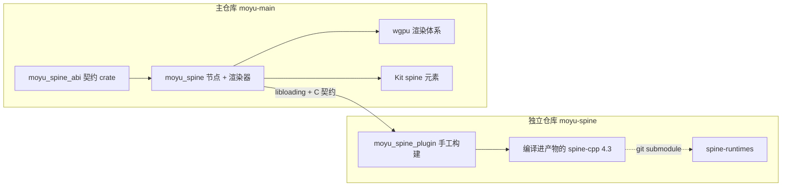

# RFC：Spine 支持与插件隔离架构

- **状态**：草案（待评审）
- **日期**：2026-10-21
- **作者**：末语项目组
- **适用范围**：`moyu_spine`（宿主接入）、`moyu_spine_abi`（契约）、`moyu_spine_plugin`（独立仓库产物）、`@momoyu-ink/kit`、`@momoyu-ink/gallery`
- **相关实现**：待实现（`crates/spine/`、`crates/spine-abi/`；独立仓库 `moyu-spine`）
- **相关 RFC**：[基础节点系统](./2026-07-20-node-system.md)

## 摘要

末语通过两层结构接入 Spine：

1. `moyu_spine_plugin`（独立仓库、手工构建）内部编译官方 `spine-cpp` 4.3（经 submodule 引入），把模型解析、骨骼求值、约束、物理、裁剪与合批全部封装在插件内，对外暴露一组自制 C 契约。
2. `moyu_spine`（本仓库 `crates/spine`）用 `libloading` 加载插件，提供独立的 `spine` 节点，接收后端无关的绘制批次，由 wgpu 完成渲染。

几个关键判断：

- Spine Runtime 是公开源码，插件内部直接编译 `spine-cpp`，无需在运行期加载任何专有运行时；
- 官方 `SkeletonRenderer` 已在 runtime 核心中提供，输出批次化几何，宿主侧无需参与裁剪与合批；
- 许可证约束落在产物使用者与再分发环节：集成本身免费（Runtimes 许可的 Otherwise 路径），但这仍是插件**不随引擎分发**的独立理由；
- 首版只支持 4.3，不实现 Web。

## 背景

Spine 是 2D 骨骼动画的主流格式，视觉小说中大量角色使用它。接入需要同时满足以下约束：

- 模型数据只能由官方 runtime 解析与求值（`.json` / `.skel` + `.atlas`），引擎不自行实现解析与求值；
- 官方语义层是 C++ 实现，引擎主仓库是 Rust / MPL-2.0；runtime 源码与引擎内容的存放边界需要明确；
- 引擎已有 wgpu 渲染体系与外部插件加载先例（视频解码库），不希望引入第二套图形 API；
- 剧本侧需要多轨动画、混合、暂停、跳转与事件回传，时间轴必须由引擎掌控；
- Spine Runtimes 的许可证要求在再分发时随附许可声明、且产物使用者自行持证，而不要求集成方先持证；交付形态据此选择最优解。

因此 Spine 不适合作为主仓库内的普通依赖，也不适合由插件自行绘制。插件负责“把模型算出来”，引擎负责“把结果画出来”。

## 先例调研

### 官方 runtime 形态（已在源码层核实）

`spine-runtimes` 4.3 分支同时提供 `spine-cpp` 与 `spine-c`：

- `spine-cpp` 是语义层的唯一实现，包含解析、求值、物理、裁剪与 `SkeletonRenderer`；
- `spine-c` 是**从 `spine-cpp` 自动生成的 C 包装**，构建时仍需同时编译 `spine-cpp/src` 与 `spine-c/src`，不构成“绕开 C++”的方案；4.3 对这套 API 做了整体重写，函数名与类型层级仍在演进；
- `SkeletonRenderer::render()` 输出链路形态的 `RenderCommand`：位置、UV、亮色、暗色、索引、混合模式、纹理指针，并按纹理/混合/首顶点颜色合批；
- 合批条件只约束索引**数量**（`numIndices + cmd->numIndices < 0xffff`），不约束索引**范围**；
- atlas 页带 `pma` 标记（`AtlasPage::pma`），页表因此可以逐页告知宿主输入是否已预乘；`spine-cpp` 的渲染接口本身不读该标记，预乘与混合因子仍由集成方按页元数据决定；
- 4.3 新增 `BonePose` / `SlotPose` / `Posed` 姿态体系、`Slider` 约束、convex/inverse clipping，`SkeletonRenderer` 因此不需要宿主侧参与裁剪。

### 其他接入路径

| 路径 | 形态 | 判断 |
| --- | --- | --- |
| 直接编译 `spine-cpp`（本方案） | C++ 语义层 + 自制 C ABI | 路径最短，与官方行为一致 |
| 使用 `spine-c` | 生成式 C 包装 | 仍编译 C++；多一层生成代码与不稳定的 C 命名 |
| 纯 Rust 重写（第三方 `spine2d`） | 独立实现，MIT/Apache 声明 | 见“被否决的方案” |
| 主仓库 feature flag 直接集成 | 依赖与发行耦合 | 会把 runtime 带进引擎发行物，所有用户都被卷进 Runtimes 许可 |

### 许可证事实（原文核对）

Runtimes 许可在 `spine-cpp/LICENSE`（即 Editor 许可 Exhibit A）里给出**两条并列路径**：

1. **走 §2**：集成、派生与分发均按 Editor 许可的条款执行。§2.1 要求集成时持有有效 Editor 许可；§2.2 允许分发，但必须随附 Runtimes 许可；§2.3 允许第三方分发，但不得允许其在未自行持证的前提下修改；§2.4 点名 SDK / 工具包 / 软件库场景，这类产品的**使用者**各自需持证。
2. **Otherwise 路径**：不走 §2 也可以集成与派生，条件是**每个产物使用者**自行取得 Editor 许可，且再分发时随附许可与版权声明。

`spine-c/README.md` 对此的表述是：可以免费把 Runtimes 集成进软件，但**软件的使用者**必须各自拥有许可；并注明“这个选项常被做开发工具的人选择，例如 SDK、游戏工具包或软件库”。

工程含义（不构成法律意见）：

- **写适配层、编译插件、本地开发与调试不受许可限制**，否则任何人在验证可行性前就必须先买授权，这条产品线不会成立；
- 义务落在**产物使用者**身上：拿到含 runtime 的插件去构建游戏的人需要自备 Editor 许可；
- 再分发（把插件交给第三方）必须随附许可与版权声明；
- Trial 许可明确不覆盖 §2，不能用来走第一条路径。

因此“插件不随引擎分发”是**产品选择**而不是法律强制：把 runtime 塞进引擎发行物会把所有用户（包括根本不用 Spine 的）卷进 Runtimes 许可。分开交付让义务只落在真正用 Spine 的人身上，同时保持仓库与发行物清洁。

## 目标

- 确定插件 / 宿主 / 契约三层职责与 SDK 内容隔离规则；
- 确定插件与宿主之间的 C 契约：版本协商、导出函数、页表、批次、事件、文件访问、错误与内存约定；
- 确定宿主渲染语义：坐标与布局、四种混合、双色着色、贴图输入编码与采样；
- 确定 `spine` 节点的属性、命令与事件基线；
- 确定平台矩阵与降级行为；
- 确定交付形态与许可证义务的落点。

## 非目标

- Web 平台实现（`spine` 节点在 Web 上保持不可用并给出明确状态）；
- 4.3 之外的 runtime 版本，以及同进程加载多个版本的插件；
- 骨骼级通用编辑接口（`setBone` 一类），首版不提供；
- 混合皮肤（mix-and-match）组合、运行时图集重打包；
- 单个模型跨多个 `.atlas` 文件（单文件内的多 page 块已支持）；
- 骨骼坐标查询、插槽/骨骼跟随节点、约束运行时改写；
- 事件内嵌音频的自动播放（仅上报路径与音量/平衡）；
- 插件内部状态的存档序列化（读档由项目重建节点并重放命令）；
- 引擎侧对插件的获取、打包与放置工具化（插件由使用者手工构建与放置）；
- spine-ue / spine-godot 等第三方引擎集成。

## 术语

| 术语 | 含义 |
| --- | --- |
| runtime | 官方 Spine Runtimes C++ 实现（`spine-cpp`） |
| 插件 | `moyu_spine_plugin`，独立仓库产物，内含编译后的 runtime |
| 宿主 / 引擎 | 末语引擎，本文指 `crates/spine` 及其上层 |
| 契约 | `moyu_spine_abi`，`repr(C)` 类型与版本常量的唯一定义来源 |
| 页 | atlas 页，一张贴图及其采样设置 |
| 页绑定 | 插件为每页维护的稳定对象，用于把 runtime 的纹理指针映射回页索引 |
| 批次 | runtime 输出的一个可绘制单元：同一页、同一混合、同一顶点色的一组三角形 |
| 参考包围盒 | setup pose 下计算的 AABB，用于节点固有尺寸与原点，不随动画或皮肤变化 |
| 世界单位 | Spine 建模坐标系中的长度单位，y 向上 |

## 总体架构



各层职责：

1. **`moyu_spine_plugin`**（独立仓库、手工构建）：
   - 编译官方 `spine-cpp`，持有模型生命周期：解析、骨骼求值、约束、物理、裁剪、动画状态、合批；
   - 通过自定义 `TextureLoader` 建立页绑定并输出页表，不读取贴图像素；
   - 在 `get_frame` 中输出批次化几何与逐顶点颜色（含把未预乘的顶点色按 alpha 预乘）；
   - 不接触任何图形 API，不创建 GPU 资源。
2. **`moyu_spine_abi`**（本仓库内独立小 crate）：`repr(C)` 类型、版本常量、错误码的唯一定义来源。该 crate 只服务 Spine，**不与任何其他契约共享代码**：跨领域抽取公共层只会让多份契约互相牵制。
3. **`moyu_spine`**（本仓库 `crates/spine`）：
   - `libloading` 加载插件并做版本协商；
   - 提供 `spine` 节点（属性、命令、事件）与 wgpu 渲染器；
   - 接管贴图加载（走引擎资源系统）、页采样设置、参考包围盒到布局的映射；
   - 插件缺失或版本不匹配时节点保持不可用状态。
4. **Kit / Gallery**：`<spine>` intrinsic element 的 TS 声明与手动测试页。

## 隔离边界

**内容归属**

- 本仓库与引擎发行物不含任何 Spine runtime 源码或二进制；
- 插件产物由自行构建，内含编译后的 runtime；runtime 源码经 git submodule 指向官方仓库，父仓库树里只记录提交哈希；
- 插件仓库只含适配层（C++ shim、Rust glue、构建脚本）；
- 引擎仓库可做特征串自检（`spine-cpp`、`SkeletonRenderer` 一类标识零命中）作为边界验证手段。

**分发义务的落点**

| 行为 | 义务 |
| --- | --- |
| 末语写适配层、编译插件、本地开发调试 | 不受许可限制（Otherwise 路径） |
| 末语把插件交给游戏开发者 | 分发含 Runtimes 的产物，需随附许可与版权声明 |
| 使用者用插件构建自己的游戏 | 使用者需自行持有 Editor 许可 |
| 第三方修改或派生 runtime | 需自行持有 Editor 许可 |
| 想要分发给未持证者且不转移义务 | 需走 §2 路径，即分发方自己持证 |

引擎与 CLI 不下载、不打包、不分发插件。插件在项目与游戏发行物中的放置由使用者自行处理，与引擎的工具链无关。

**插件侧实现要点**

- 编译集合：`spine-cpp/src` 全部源文件与 `spine-cpp/include`；不接入 `spine-c`；
- atlas 接入：用 `Atlas(data, length, dir, textureLoader)` 内存构造，字节经宿主 `read_file` 回调取得；`dir` 为 atlas 所在目录，供解析页图相对路径；
- 附件加载器：`AtlasAttachmentLoader` 只接受单个 `Atlas`，多 page 块由单个 `.atlas` 文件内的多个 page 覆盖；跨多个 `.atlas` 文件需自写 `AttachmentLoader`，不在首版范围；
- runtime 源码：以 git submodule 引用官方 `spine-runtimes`，固定到具体提交；不复制源码进仓库；
- 版本锚点：submodule 指针即完整版本记录；构建脚本另读 `spine-cpp/include/spine/Version.h` 校验主次版本为 4.3，并把提交哈希写入 `PluginInfo` 供诊断；
- 构建前提示：`build.rs` 在 submodule 未初始化时给出可操作的错误（附 `git submodule update --init` 命令），不尝试自动拉取；
- 符号可见性：插件默认只导出 `moyu_spine_plugin_*` 入口（`-fvisibility=hidden` / 导出列表 / `__declspec` 限定），避免 runtime 符号与其他库串用；
- 边界处不抛异常、不 panic，统一转错误码。

**宿主侧要点**

- 宿主只依赖 `moyu_spine_abi`，不感知 runtime 的存在；
- 贴图、文件、时间、资源回收均由宿主负责；
- 插件上下文按进程级单例使用，各节点持有独立模型；
- 插件调用固定在脚本线程，渲染线程只消费拷贝出来的快照。

## 平台矩阵

| 平台 | 插件形态 | 说明 |
| --- | --- | --- |
| Windows | `moyu_spine_plugin.dll` | 使用者构建 |
| Linux | `libmoyu_spine_plugin.so` | 同上 |
| macOS | `libmoyu_spine_plugin.dylib` | 同上 |
| Android | `libmoyu_spine_plugin.so` | 同上，随 APK 打包 |
| Web | 无插件 | 节点不可用并上报状态 |

## C 契约

契约定义在 `moyu_spine_abi`。本节为设计基线；字段与签名以实现评审为准，但语义边界不得收紧。

### 版本与协商

- `..._abi_version() -> u32`：编码为 `major << 16 | minor`；宿主只加载主版本一致的插件；
- `..._caps() -> u64`：保留能力位，首版固定为 0；
- `..._query_info(handle, out)`：报告插件所编译的 runtime 精确版本串与 ABI 版本，仅用于诊断。

版本维度分离，互不替代：

| 维度 | 用途 |
| --- | --- |
| ABI 版本 | 判断宿主能否调用插件 |
| runtime 版本 | 复现行为与定位问题 |
| 模型数据版本 | `SkeletonData::version`，模型由哪个 Editor 导出 |

模型数据版本只用于错误诊断（“该模型由 4.3.x 导出，插件基于 4.3.y”），不用于路由，也不做“先试读、失败再换实现”的回退。

### 导出函数

| 函数 | 用途 |
| --- | --- |
| `..._plugin_create(init, out_handle)` | 初始化插件：接收文件访问回调 |
| `..._plugin_destroy(handle)` | 释放插件 |
| `..._plugin_last_error() -> span` | 无句柄阶段的错误消息 |
| `..._load_model(handle, desc, out_model)` | 加载模型：`ModelDesc` 含骨架路径与可选 atlas 路径（空则同目录同主名推导） |
| `..._unload_model(handle, model)` | 卸载模型 |
| `..._update(handle, model, delta)` | 推进一帧求值 |
| `..._get_frame(handle, model, out_frame)` | 取当前批次快照 |
| `..._set_paused(handle, model, paused)` | 暂停推进（保持状态） |
| `..._set_time_scale(handle, model, scale)` | 时间缩放 |
| `..._set_physics(handle, model, mode)` | 物理模式：none / pose / update |
| `..._reset_physics(handle, model)` | 一次性重置物理状态 |
| `..._set_skin(handle, model, name)` | 切换皮肤，并把槽位恢复到 setup pose；由节点的 `skin` 属性驱动 |
| `..._set_animation(handle, model, track, name, loop, mix, time, out_entry)` | 替换该轨动画，返回 entry 标识；`time` 为起始播放时间 |
| `..._add_animation(handle, model, track, name, loop, delay, mix, time, out_entry)` | 排队动画；`delay` 与 `mix` 按官方联动规则处理 |
| `..._clear_track(handle, model, track, mix)` | 清空该轨（`mix > 0` 时淡出） |
| `..._clear_tracks(handle, model, mix)` | 清空全部轨道 |
| `..._set_mix(handle, model, from, to, duration)` | 配置动画对之间的过渡时长 |
| `..._set_default_mix(handle, model, duration)` | 配置默认过渡时长 |
| `..._set_attachment(handle, model, slot, name)` | 切换附件（空名表示移除） |
| `..._reset_to_setup_pose(handle, model)` | 显式回到 setup pose |
| `..._hit_test(handle, model, x, y, out_name)` | 包围盒命中测试；输入为 **世界坐标**，输出命中框名称（空 span 表示未命中） |
| `..._query_model(handle, model, out)` | 模型信息：数据版本、参考包围盒 |
| `..._query_animations(handle, model, index, out, out_count)` | 动画清单（两段式） |
| `..._query_skins(handle, model, index, out, out_count)` | 皮肤清单（两段式） |
| `..._query_pages(handle, model, index, out, out_count)` | 页表（两段式） |
| `..._query_bounding_boxes(handle, model, index, out, out_count)` | 包围盒清单（两段式） |
| `..._poll_event(handle, model, out_event)` | 拉取事件 |
| `..._last_error_of(handle) -> span` | 有句柄阶段的错误消息 |

列表查询两段式：`index < 0` 时只回填数量。返回值有效至模型卸载（页表随模型重载整体替换）。

`ModelDesc` 两个字段：

| 字段 | 说明 |
| --- | --- |
| `skeleton_path` | `.skel` 或 `.json`，相对资产根 |
| `atlas_path` | 可选；空 span 时由插件取骨架同目录同主名 |

骨架与 atlas 都经 `read_file` 回调取字节，插件不直接读盘。

### 文件访问

- 宿主在 `create` 时提供 `read_file(user_data, path, offset, buffer, inout_len)`，两段式语义：`buffer` 为空时回填可用字节数，否则拷贝并回填拷贝量；
- `path` 一律相对资产根（`assets/`）；插件负责把模型文件内的相对引用解析为资产根相对路径后传入；
- 回调在主线程同步执行，宿主不得在回调内重入插件；
- 字节有效至回调返回；插件自行负责所需的对齐与生命周期。

### 模型元数据

加载完成后可查询，有效至卸载：

| 项 | 内容 |
| --- | --- |
| 模型信息 | 数据版本串、参考包围盒（`x/y/width/height`，世界单位） |
| 动画清单 | 名称、时长 |
| 皮肤清单 | 名称 |
| 页表 | 路径、宽高、输入 alpha 编码、缩小/放大过滤、U/V 环绕 |
| 包围盒清单 | 名称（供命中测试与调试） |

参考包围盒在“初始皮肤已应用”的 setup pose 下计算一次并固定。它只用于节点固有尺寸与原点换算，不逐帧更新，也不作为节点自身的裁剪边界（节点不裁剪超出部分）。但引擎的祖先效果节点会按布局矩形建立离屏区域：`filter` 使用子树的 `global_content_bounds()`，因此超出该矩形的部分在滤镜内会被裁掉。这是布局系统的既有行为，记在已知限制里。

### 更新与快照

- 宿主每帧调用 `update(delta)`；插件没有内部时钟，暂停与时间缩放由宿主显式下发；
- 物理模式分三态（不更新 / 只摆姿势 / 完整推进），与官方 `Physics` 语义一致；大 delta 的钳制由宿主负责；
- 快照为**临时绘制流**，不是稳定的可绘制集合：批次数量、顺序与归属每帧都可能变化；
- 快照与其中所有指针**有效至下一次任何插件调用**（不止 `update`）。宿主必须在下次调用前完成深拷贝；契约不承诺“到下一帧为止”。
- 宿主不得按纹理或混合模式重排批次，必须按插件给定顺序提交。

### 绘制数据

坐标约定：

- 顶点为 **Spine 世界坐标**（y 向上，单位 = 世界单位）；
- UV 为归一化坐标，左上原点、y 向下；runtime 输出的 UV 已按页高归一化（`v = y / page.height`），宿主按原有朝向采样即可，**不得再做一次 `v = 1 - v`**；
- 逐顶点颜色为 RGBA8，打包为 `u32 = b | g<<8 | r<<16 | a<<24`（与 runtime 的输出布局一致，避免逐顶点重排）；
- `colors` 的 RGB **已按 A 预乘**；`dark_colors` 的 RGB 也同样按该 A 预乘，其自身 A 恒为 1；未使用双色时 `dark.rgb` 为 0。

预乘由插件在转换批次时完成（每顶点一次乘法），因为 runtime 只输出未预乘的顶点色。`light.rgb` 与 `dark.rgb` 同乘最终 alpha，`dark.a` 保持 1。这样贴图与顶点色在宿主侧处于同一空间，宿主着色器不需要再判断输入形态。

宿主上传约定：

- 索引数据补齐到四字节倍数（三角形数可以不是偶数，`6`/`18`/`30` 字节都不对齐），补齐只影响上传字节，绘制索引数保持原值；
- 每次写入的目标区间必须互不重叠：引擎把 staging 拷贝录进独立 encoder，在本帧绘制 encoder 之前统一提交，`Write(A) → Draw(A) → Write(B) → Draw(B)` 不会让 GPU 按序看到两次写入。同一帧内每批次的顶点、索引与 uniform 都要各自独立分配区间或独立缓冲。

`FrameDesc`（每帧快照根）：

| 字段 | 说明 |
| --- | --- |
| `batches` / `batch_count` | 批次数组，已按绘制顺序排列 |
| `vertex_count_total` / `index_count_total` | 合计，供宿主做上限校验 |

`BatchDesc`：

| 字段 | 说明 |
| --- | --- |
| `texture_page_index` | 页表索引；越界即为契约违背 |
| `blend_mode` | 插件已定下的有效模式：`NORMAL` / `ADDITIVE` / `MULTIPLY` / `SCREEN` |
| `flags` | 保留位，首版为 0 |
| `vertex_count` / `index_count` | 顶点数与索引数 |
| `positions` | 世界坐标 |
| `uvs` | 归一化 UV |
| `colors` | 亮色，RGB 已按 A 预乘（插件完成预乘） |
| `dark_colors` | 暗色，RGB 同样已按该 A 预乘，A 恒为 1 |
| `indices` | `u16` 三角形索引 |

`PageDesc`：

| 字段 | 说明 |
| --- | --- |
| `path` | 相对资产根 |
| `width` / `height` | 页像素尺寸；必须为正，缺失或不大于 0 时加载失败 |
| `alpha` | 输入编码：`STRAIGHT` / `PREMULTIPLIED` |
| `min_filter` / `mag_filter` | `NEAREST` / `LINEAR` / `MIPMAP_*` 变体 |
| `wrap_u` / `wrap_v` | `CLAMP` / `REPEAT` / `MIRROR` |

采样状态是**逐页**的，宿主必须按页应用，不得所有页共用一个采样器：Spine 素材里最近邻采样的像素风页与需要平铺的页都真实存在，统一成线性 + clamp 会让前者发虚、后者在边缘出现拉伸。宿主侧的采样器应按页（或以采样状态为键缓存）创建，并与该页的 bind group 绑定。

### 批次校验

`u16` 是整个 runtime 的原生索引类型，不是某个中间步骤的临时表示：`MeshAttachment` 的三角形索引本身就是 `Array<unsigned short>`，`SkeletonClipping` 裁剪出的索引数组同为 `unsigned short`，`RenderCommand` 也按 `uint16_t` 分配。也就是说，一旦单个网格或裁剪结果超过 65535 个顶点，失真是**导入与裁剪阶段**发生的，插件没有“缩窄之前”可以干预的时机。

因此契约能承诺的只有“检测并明确失败”，而不是“重新分组以避开上限”。上游的合批（`batchCommands`）另有一处宽松：它只按 `numIndices + cmd->numIndices < 0xffff` 决定是否合并，不校验 `numVertices` 是否越过上限，也不校验索引范围。

插件侧约束：

- 交付单位是上游合批后的每条 `RenderCommand`，插件**不重新合批**，避免引入与官方后端不一致的批次边界；
- 对每条批次逐项校验：`vertex_count <= 65536`、每个索引值 `< vertex_count`、计数字段与数组长度一致、页索引可反查；
- 校验失败报 `UNSUPPORTED` 并给出是哪一项越界，取帧整体失败，不输出部分批次、不静默截断；
- 上述校验的触发条件是素材本身超限（现实中的 4.3 素材不会踩到），因此正常素材的路径上没有额外开销。

宿主侧对越界页索引、`vertex_count > 65536`、索引值 `>= vertex_count` 同样报错并丢弃该帧，不降级成第 0 页或部分绘制。

**纹理指针不出插件**：插件在纹理加载钩子中为每页建立地址稳定的绑定对象，并让 runtime 的纹理字段指向该对象；输出批次时反查页索引。未知指针视为内部错误。页绑定地址不得依赖会因扩容而移动的容器元素。

### 事件

拉取式队列。事件不仅会在 `update` 中产生，`set_animation` / `clear_track` 等命令内部也会同步触发；因此宿主在**每次命令调用之后、`update` 之后、以及暂停期间**都要排空队列。载荷字符串有效至下一次调用。

插件侧约束：事件在 runtime 回调内当场复制进自有队列（含字符串），不能保存 `TrackEntry*` 等到 `poll_event` 再读——runtime 会在回调结束后回收 entry。`entry_id` 在命令返回前就已分配，因此同步触发的 `START` 不会早于身份可用。

| 字段 | 说明 |
| --- | --- |
| `kind` | `START` / `INTERRUPT` / `END` / `COMPLETE` / `EVENT` / `DISPOSE` |
| `track_index` | 轨道编号 |
| `entry_id` | 插件分配的单调标识，`set/add_animation` 时回传 |
| `animation` | 动画名 |
| `name` | 用户事件名（`EVENT` 时） |
| `int_value` / `float_value` / `string_value` | 用户事件载荷 |
| `audio_path` / `volume` / `balance` | 用户事件音频信息，仅供上报 |

语义约束（均按 4.3 `AnimationState` 的实际行为）：

- `COMPLETE` 表示当前轮到达终点。循环动画每轮触发一次，**但一次更新跨过多轮时只补发一次**，不能按次数计循环；
- 非循环动画自然完成后，默认**不会**产生 `END`：`trackEnd` 初始为 `FLT_MAX`，entry 持续应用末帧；
- `END` 只在设置了结束时间的路径上产生（如清轨或淡出）；`END` 之后仍会有 `DISPOSE`；
- 未开始就被取消的排队 entry（`clearNext`）**只有 `DISPOSE`，没有 `END`**，也没有 `COMPLETE`；
- `INTERRUPT` 表示同轨被新 entry 替换；
- `DISPOSE` 表示 entry 即将被回收，是插件侧的最后一次通知；它**不是**播放结果的信号，但宿主必须把它当成对应等待的终止事件，否则被取消的排队动画永远等不到结果；
- `audio_path` 不触发自动播放。

因此节点层不把 `END` 当作“播放完成”来暴露。一个 entry 的生命周期终结统一由 `trackDispose` 事件表达；完成、打断、取消都能收到它。

### 错误与内存约定

- 全部函数返回 `i32` 错误码：0 成功；非 0 分类错误（参数 / 版本 / 文件 / 解析 / 不支持 / 内部）；
- 失败后经 `..._last_error_of` 读取 UTF-8 消息（span，有效至下次调用）；
- 字符串一律 UTF-8 span，不要求 NUL 终止；空 span 表示“不存在”；
- 插件持有的内存由插件释放；宿主不释放任何插件指针；
- C++ 异常不得跨越 C ABI。

## 宿主渲染语义

### 坐标与布局

宿主把世界坐标映射到节点局部空间，只有一次平移：

1. 水平平移 `-bounds.x`；
2. 垂直平移 `-bounds.y`；
3. 之后应用节点通用变换（位移、缩放、旋转）。

**不做 y 翻转。** 两个独立原因都指向同一结论：

- `spine-cpp` 的 `Bone::yDown` 默认为 `true`，`Skeleton::getScaleY()` 会在其中返回 `-1`，因此模型世界坐标本身已经是 y 向下，与末语节点空间同向；
- 末语引擎的 MVP 在节点空间到 clip 空间之间也有一次纵向取反（与 `sprite` 等节点共用同一约定）。

任何一边再翻一次都会得到上下颠倒的模型。这一点以 `spineboy`（单页、含网格变形）、`dragon`（6 页、含混合模式）的实机对照为准，不以推导为准。

节点固有尺寸取参考包围盒的宽高（世界单位与布局单位 1:1），显示缩放走节点变换属性。

参考包围盒为零或无效时固有尺寸即为零：布局矩形为零，引擎的可见性判断与命中判断不会命中它，节点仍可操作但不绘制，命令照常生效，不作为错误处理。

**参考包围盒的测量顺序**：`Skeleton` 构造时即把 setup pose 写入 `_pose` 且 `_appliedPose` 指向它，因此 `setupPose()` 之后直接 `updateWorldTransform(Physics::none)` 再 `getBounds()` 即可。JS/Rust 侧不需要（也不应该）先跑一次 `AnimationState::apply`——空轨道的 `apply` 不会给模型任何东西，它只按已有轨道写 pose。

**参考包围盒不保证包住全部动画帧**：`getBounds()` 统计的是当前 pose 的 region/mesh 几何 AABB，不是骨骼或包围盒的并集。动画把角色移出该矩形属于正常现象，见「已知限制」。

**空结果的处理**：`getBounds()` 在没有任何 region/mesh 计入时返回极值（`FLT_MAX` / `-FLT_MAX` 一类），不是零矩形。插件必须把非有限或非正的宽高归一化为 0，且不得把极值传进布局。

参考包围盒与引擎节点 bounds 是两回事：前者是 runtime 在当前姿势下输出的几何 AABB，只在加载时读取一次；后者是末语 `NodeBase` 由 `layout_size` 推导的布局矩形（`content_bounds`），不跟踪动画几何。

**不做背面剔除**。宿主不翻转，绕序保持 runtime 输出；但 Spine 的骨骼负缩放与镜像会翻转局部绕序，runtime 也不提供逐附件的双面信息，因此负缩放与镜像用例两侧都必须可见。

命中测试与任何坐标查询必须使用同一套变换。节点侧的 `hitTest` 命令与 `hit` 事件都使用节点局部坐标（平移之后），宿主在调用插件前把它反变换回世界坐标（`world = local + bounds.origin`）；契约的 `..._hit_test` 只接受世界坐标。

**命中只统计「当前启用」的包围盒**：皮肤里定义了一个 bounding box，只表示该附件可供选择；它是否参与命中，取决于对应槽位当前是否挂着它。多数编辑器导出的槽位没有 `attachment` 字段，setup pose 下这些槽位是空的，于是 `SkeletonBounds` 收集到 0 个多边形、任何点击都返回空——这是资产语义的正常表现，不是插件缺陷。

因此：

- 插件**不得**回退到 setup 附件名或自动启用包围盒来「修复」空结果：动画通过 attachment timeline 开关判定框（例如只在某个攻击窗口启用）是合法用法，回退会把已经被关掉的框重新打开，破坏模型语义；
- 需要命中的项目应显式调用 `setAttachment(slot, boxName)`（或直接在编辑器里给槽位配上 setup 附件后重新导出）；
- 宿主把命中结果按原样上报，空结果就是「当前没有命中」，不视为错误。

### 混合

片元输出预乘 alpha，混合因子与官方预乘路径一致：

| 模式 | RGB 源 / 目标 | Alpha 源 / 目标 |
| --- | --- | --- |
| Normal | One / OneMinusSrcAlpha | One / OneMinusSrcAlpha |
| Additive | One / One | One / One |
| Multiply | DstColor / OneMinusSrcAlpha | One / OneMinusSrcAlpha |
| Screen | One / OneMinusSrcColor | One / OneMinusSrcAlpha |

四种模式四组管线，不设剔除变体。插件已把不支持的组合降级为 Normal，宿主不解释原始编码。

Additive 的 alpha 取 `One / One` 是本引擎的合成策略：官方各后端在这里并不统一（有的用 `One / One`，有的用“加色 RGB + 零 alpha”的优化路径）。选 `One / One` 使目标 alpha 随加色分量累积，叠在透明离屏层与滤镜里时遮挡关系与直绘一致；需要以透明背景的验收用例验证这一选择。

### 双色着色

逐顶点使用亮色与暗色两套完整 RGBA 颜色，片元按官方公式计算：

```
alpha = tex.a * light.a
rgb   = ((tex.a - 1) * dark.a + 1 - tex.rgb) * dark.rgb + tex.rgb * light.rgb
```

`dark` 是完整的逐顶点 `vec4`，`dark.a` 参与计算，不因当前后端恰好输出 1 就在契约或着色器里做化简——顶点属性保持 dtype 完整，化简属于权衡失当的过早优化。

无双色染色的顶点 `dark.rgb` 为 0，公式退化为 `tex.rgb * light.rgb`。

节点 tint 与不透明度作用于**最终着色结果**的两项，不是只乘亮色：`light.rgb` 与 `dark.rgb` 都要随同一个最终 alpha 缩放。官方 WebGL 后端就是这么做的（`light.rgb *= alpha` 与 `dark.rgb *= alpha`），而 `dark.a` 固定为 1、不参与这次缩放。

### 贴图与采样

- 贴图由宿主资源系统加载，按页表逐页设置过滤与环绕；
- 纹理必须支持两种输入 alpha 编码，GPU 存储统一为预乘：straight 输入预乘一次，已预乘输入跳过；
- 缓存身份必须包含输入编码，否则同一路径的两种请求会错误复用；
- mipmap 在归一化之后生成；
- 不得采用“先反预乘、再让现有入口重新预乘”的实现——低 alpha 像素会被放大量化误差，alpha 为零的 RGB 无法恢复；
- 仅支持 RGBA8 页格式；Alpha / Intensity / RGB565 等格式返回明确错误，不做近似转换。

## 节点与 Kit API（设计基线）

节点类型：`spine`；Kit 以 `<spine>` intrinsic element 暴露。

属性（均为声明式状态，只在变更时下发，不做无变化的逐帧重设）：

| 属性 | 类型 | 默认值 | 说明 |
| --- | --- | --- | --- |
| `src` | `string` | 必填 | `.skel` 或 `.json` 路径，相对 `assets/` |
| `atlas` | `string` | 空 | `.atlas` 路径；为空时取 `src` 同目录同主名 |
| `skin` | `string` | 空 | 皮肤名；变更时切换皮肤并复位槽位 |
| `timeScale` | `number` | `1` | 时间缩放 |
| `paused` | `boolean` | `false` | 暂停推进，保持当前姿势 |
| `physics` | `'none' \| 'pose' \| 'update'` | `'update'` | 物理模式 |
| `hitArea` | `boolean` | `false` | 按下指针时做包围盒命中并上报 `hit` 事件 |

命令（一次性动作）：

| 命令 | 参数 | 说明 |
| --- | --- | --- |
| `setAnimation` | `{ track?, name, loop?, mix?, time? }` | 替换该轨；`track` 默认 0，`time` 为起始播放时间 |
| `addAnimation` | `{ track?, name, loop?, delay?, mix?, time? }` | 排队播放；`delay` 与 `mix` 遵循官方联动规则 |
| `clearTrack` | `{ track?, mix? }` | 清空该轨；`mix > 0` 时淡出 |
| `clearTracks` | `{ mix? }` | 清空全部轨道 |
| `setMix` | `{ from, to, duration }` | 动画对过渡时长 |
| `setDefaultMix` | `{ duration }` | 默认过渡时长 |
| `setAttachment` | `{ slot, name }` | 切换附件，空名移除 |
| `resetToSetupPose` | — | 显式回到 setup pose |
| `resetPhysics` | — | 一次性重置物理状态 |
| `hitTest` | `{ x, y }` | 命中测试，x/y 为节点局部坐标，返回命中框名称或空 |

属性与命令的分工：属性是状态（声明一次，变更时下发），命令是时点动作（每次调用都执行）。

`hitArea` 属性与 `hitTest` 命令名字不同、职责不同：前者是开关，决定按下指针时是否自动命中并上报 `hit` 事件；后者是主动查询，返回指定坐标的命中框名称。关闭属性后仍可显式调用命令。

`stopAnimation` 一类含义过载的命令不提供：暂停用 `paused`，清轨用 `clearTrack`，淡出用 `clearTrack{mix}`，复位用 `resetToSetupPose`。

几条容易被误当“包一层 runtime 函数”的行为规则：

- **空轨淡入**：该轨原本为空时，仅设 `mix` 不会产生从下层姿势淡入的效果，因为没有 mixing-from entry（`setAnimation` 里 `newTrackEntry` 拿到的是 null）。因此 `setAnimation` 在「轨为空且 `mix > 0`」时必须先用 empty animation 建立 mixing-from，再切到目标动画，否则首次叠加表情/手势会跳变。`clearTrack{mix}` 不需要这一步：它的目标本来就是静默，`setEmptyAnimation` 对已有 entry 的轨道就是淡出。
- **`delay` 与 `mix` 联动**：默认 mix 参与 `delay <= 0` 时的开始时间计算。同时传自定义 `mix` 时，必须走“设置 mixDuration 并同时重算 delay”的路径，否则过渡结束点仍按旧值计算。
- **seek**：`time` 只设置当前 entry 的播放位置，不重放被跨过的用户事件；跳转后物理不重新初始化（需要时显式调 `resetPhysics`）。
- **暂停**：`paused` 停止推进动画与骨架时间，但**仍执行零时间求值**：换皮肤、换附件、复位姿势、参数变更都要在下一帧生效，命中几何同样要刷新。
- **复位**：`resetToSetupPose` 清姿势与轨道。只清姿势不清轨道的话，下一次应用动画会立刻覆盖它。
- **附件与皮肤**：`setAttachment` 与 `skin` 都是持久状态；若当前动画的附件时间线覆盖了该槽位，下一帧会被动画改写——这是官方行为，不做特殊处理。
- **物理三态**：`none` 表示不更新也不应用物理（不是冻结在当前物理姿态）；冻结当前姿态用 `pose`。

事件：

| 事件 | 载荷 | 说明 |
| --- | --- | --- |
| `ready` | 元数据快照 | 模型**解析**完成；含参考包围盒、动画、皮肤、页表。贴图由宿主异步加载，不阻塞该事件 |
| `trackStart` | `{ track, animation, entry, epoch }` | 动画开始（可能在命令调用内部同步发生） |
| `trackInterrupt` | 同上 | 同轨被替换 |
| `trackComplete` | 同上 | 当前轮到达终点；循环动画每轮触发，跨多轮只补发一次 |
| `trackEnd` | 同上 | entry 停止应用（仅在设置了结束时间的路径上产生） |
| `trackDispose` | 同上 | entry 被回收；完成、打断、取消都会收到，作为生命周期的终结信号 |
| `trackEvent` | `{ track, animation, entry, epoch, name, intValue, floatValue, stringValue, audioPath, volume, balance }` | 用户事件 |
| `hit` | `{ name, x, y }` | 包围盒命中，需开启 `hitArea`；x/y 为触发命中的节点局部坐标 |
| `error` | `{ code, message }` | 插件不可用、加载失败或运行期错误 |

`epoch` 由宿主在模型重载时递增，用于区分新旧模型的同名事件；`entry` 由插件分配。两者共同构成事件身份。

`setAnimation` / `addAnimation` 的返回值就是 `{ entry, epoch }`，调用方据此等待对应播放。`entry` 在插件内部于调用返回之前就已分配，因此命令同步触发的 `trackStart` 不会早于身份可用。

模型重载时，旧模型尚未终结的 entry 由宿主为本地的等待发出一次终结事件（携带旧 `epoch`），不只做过滤。

降级行为：插件缺失、版本不匹配、runtime 与模型数据版本不符或加载失败时，节点保持为空、命令返回错误并上报一次 `error`，不触发 `ready`。

## 错误与边界行为

- 插件文件缺失：节点不可用，引擎正常启动，上报一次 `error`；
- ABI 主版本不匹配：拒绝加载并给出诊断，节点不可用；
- 模型数据版本与 runtime 不符：加载失败，错误消息同时给出数据版本与插件版本；
- 页索引越界或批次计数超限：视为契约违背，节点丢弃该帧并上报错误，不做部分绘制；
- 贴图解码失败或页格式不支持：该页相关批次跳过，上报一次错误；模型恢复后允许再次上报。此时 `ready` 已经发出——`ready` 表示**解析完成**，不表示全部贴图已就绪；需要完整可见的调用方应同时等待贴图错误与否。
- 显式命令作用于不可用节点或缺省轨道：返回错误码，不产生副作用；
- 单网格顶点数超出 `u16` 表达能力：加载或取帧失败并给出明确原因。

## 性能考量

- runtime 求值与合批为纯 CPU，插件不参与上传；
- 快照为临时流，宿主每帧整体拷贝；拷贝成本与顶点/索引总量成正比，按统一抽样方法记录；
- 顶点与索引缓冲按容量复用，按几何增长，不因每帧数量变化而重建；
- 批次顺序即提交顺序，不做全局重排以减少状态切换；
- 页表与参考包围盒只在模型重载时变化；
- 裁剪会改变拓扑并可能显著增加顶点数，需记录裁剪开销量级。

## 已知限制

- 仅 4.3，且仅一个 runtime 版本；
- 无 Web 实现；
- 仅 RGBA8 页格式；
- 不提供骨骼级编辑、混合皮肤组合、运行时图集重打包；
- 命中测试为包围盒语义，不是像素级或网格级命中；
- 逐帧全量批次快照，无增量更新；
- 同一模型的多个节点各持独立实例，无共享缓存；
- 插件需手工构建，引擎不提供自动获取；
- 布局矩形取自参考包围盒且不随动画变化：动画把角色移出该矩形很远时，引擎按矩形做的剔除会判为不可见。视觉小说场景下少见，需要时应由项目调整节点位置或改用更大的包围盒模型。
- 同一原因，`filter` 节点按子树的 `global_content_bounds()` 建立离屏区域：角色伸出参考包围盒的手、头发在被放进 `filter` 时会被离屏纹理边界裁掉。需要完整保留时，应由项目把 `filter` 上提到不含裁剪的层级，或改用更宽的包围盒模型。
- 参考包围盒在加载时按初始皮肤测量且之后不重测：之后切到的皮肤如果几何范围明显更大，布局尺寸仍以初始皮肤为准。这是“布局稳定优先于几何贴合”的取舍。
- 命中只覆盖**当前启用**的包围盒。导出的槽位若没有 setup attachment，该命中区在模型里就是不存在，需要项目用 `setAttachment` 打开——这不是缺陷，而是资产语义（动画常用 attachment timeline 开关判定框，插件不会替模型做决定）。
- 插件侧只做参考包围盒与命中查询，不提供槽位清单。要在编辑器类界面里列出可切换的附件，需要项目自己维护槽位名表；新增查询入口属于契约扩展，首版未做。

## 被否决的方案

### 主仓库直接集成（feature flag）

关闭 feature 时可以做到不含 runtime，但需要长期维护两套构建路径；且把 runtime 留在引擎仓库或发行物里会把所有用户（包括不用 Spine 的）卷进 Runtimes 许可，而分开交付可以让义务只落在真正用 Spine 的人身上。

### 使用 `spine-c`

4.3 的 `spine-c` 是从 `spine-cpp` 自动生成的包装，构建仍需编译 C++；额外引入一层仍在演进的生成 API，收益为零。自制契约的入口数量远小于生成的 C 面。

### 采用纯 Rust 第三方实现（`spine2d`）

- 该项目自述为实验性实现，明确“不保证自第一天起与官方完全一致”，0.4 与 0.5 均含破坏性 API 变更，且 MSRV 会抬高整个 workspace 的下限；
- 其 API 与语义持续向官方 C++ 对齐，权利来源无法仅凭其声明的 MIT/Apache 覆盖；
- 角色动画是核心功能，parity 缺陷需由我们承担，缺少官方支持通道。

结论：可作为本地对照工具，不作为运行时依赖。

### 同时支持 4.2 与 4.3

版本切换的正确粒度是“换插件二进制 + 重新打包”，与升级引擎同量级；常驻两套 runtime 只会引入进程级全局状态冲突与双倍验收面。方案改为选定单一版本，模型版本仅用于诊断。

### 插件自绘并共享纹理

需要插件自带图形后端并做跨 API 纹理共享，平台矩阵复杂、Web 无解，且与引擎自绘的既有架构冲突。

### 取消插件隔离，直接把 runtime 编进引擎

会把 runtime 带进引擎发行物，使所有用户都被卷进 Runtimes 许可，并在默认构建中引入 C++ 工具链与符号污染。

### 首版提供通用骨骼编辑（`setBone`）

需要先确定写入时机（动画前 / 动画后 / 约束求解后）、局部与世界坐标语义、以及下一帧由谁恢复。缺少明确需求时不应把它变成长期 API 承诺。

### 事后校验并拆批来兼容 `u16` 索引

合批与裁剪在 runtime 内部已经写到 `uint16_t`，溢出后的索引信息不可恢复，事后检查只能拒绝而不能拆分。方案改为在缩窄前约束合批与裁剪规模，超限时明确报错。

### 把双色化简为 `dark.a == 1` 的专用公式

在本方案使用的 `spine-cpp` 输出下两者等价，但化简会把一个当前恰好为常量的事实固化进契约与着色器。保留完整 `vec4` 不增加开销，也不改变画面。

## 后续工作

- Web 平台实现（官方 TS runtime 或 WASM 形态，另行立项）；
- 骨骼坐标查询与插槽/骨骼跟随节点；
- 混合皮肤组合与运行时图集重打包；
- 口型同步的音频振幅入口；
- 多节点共享模型缓存与增量快照；
- 插件构建与放置的辅助脚本（不涉及分发）；
- 逐帧几何包围盒：用于需要精确剔除或滤镜范围的项目（当前以固定参考框换取布局稳定）。

## 结论

本 RFC 确定以“使用者自建插件 + 自制 C 契约 + 宿主 wgpu 渲染”接入 Spine，runtime 内容零进入主仓库与引擎发行物。

已确认的关键决策：

- 交付形态：独立插件，不随引擎分发；集成本身免费，义务落在使用者与再分发环节；
- runtime：仅 4.3，插件内直接编译 `spine-cpp`，不接入 `spine-c`；
- 契约：独立 `spine-abi`，不与其他契约共享代码；
- 渲染：批次临时流、按序提交、无背面剔除、四种混合、逐顶点双色；
- 坐标：插件输出世界坐标，宿主负责原点平移与节点变换（不翻转）；
- 布局：参考包围盒在初始皮肤已应用的 setup pose 下测量一次，仅用于固有尺寸与原点；空结果归一化为 0；
- 贴图：宿主统一归一化为预乘，缓存身份包含输入编码；页尺寸必须为正；
- 事件：`trackDispose` 作为 entry 的终结信号，`trackComplete` 只表示当前轮到达终点；事件带 entry 与 epoch 身份，命令同步触发的事件同样入队；
- 校验：索引越界与顶点超限在**缩窄到 u16 之前**处理，不在事后修复；
- 平台：桌面与 Android，无 Web；
- 版本：单一 runtime，模型数据版本仅用于诊断。
