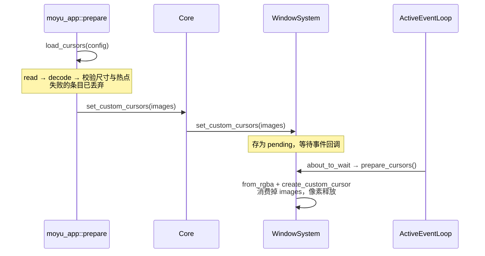

# RFC：自定义鼠标指针

- **状态**：已实现
- **日期**：2026-10-26
- **作者**：末语项目组
- **适用范围**：`moyu_pal`（配置）、`moyu`（默认 runtime 的 window system）、`packages/gallery`
- **相关实现**：`crates/platform/src/config.rs`、`crates/core/src/base/cursor.rs`、`crates/core/src/core/window_system.rs`、`crates/core/src/core.rs`、`crates/core/src/core/pointer_events.rs`、`crates/app/src/lib.rs`、`crates/moyu/src/winit_window_system.rs`、`crates/moyu/src/entry.rs`、`crates/moyu/src/headless/window_system.rs`、`packages/gallery/index.json`、`packages/gallery/src/pages/cursor.tsx`、`packages/gallery/scripts/generate-assets.mjs`
- **相关 RFC**：[窗口系统抽象](./2026-09-06-window-system-abstraction.md)

## 摘要

`index.json` 增加一个可选的 `cursor` 字段，用资源路径把鼠标指针状态映射到自定义图片。配置可以是一张图（所有状态共用）或一个按状态名索引的字典（支持 `default` 兜底）。引擎在启动时异步读取、解码并校验，把「状态 → 图片」的表交给窗口系统；窗口系统在第一次事件回调里把它们转成平台光标，之后不再变。

能力完全来自 winit 的 `CustomCursor`：只支持静态图片，热点由配置给出，不做按 DPI 或舞台倍率缩放。加载期间沿用系统指针，加载失败按 `状态 → default → 系统指针` 逐级回退。

## 背景

### 现状

- `MoyuCursor`（`crates/core/src/base/cursor.rs`）只有两种形态：`Visible(cursor_icon::CursorIcon)` 与 `Hidden`。它的字符串表示与 `CursorIcon::name()` 完全一致（`pointer`、`move`、`no-drop` 等 kebab-case 名字），因此节点上的 `cursor` 属性已经能表达全部系统指针状态。
- 指针命中节点变化时，`Core::set_cursor`（`crates/core/src/core.rs`）用 `ArcSwap` 去重，值变化才调用 `WindowSystem::set_cursor`；指针离开所有节点时回落到 `Visible(CursorIcon::Default)`（`crates/core/src/core/pointer_events.rs`）。
- 默认 runtime 的实现（`crates/moyu/src/winit_window_system.rs`）直接调用 `window.set_cursor(icon)` 与 `window.set_cursor_visible(false)`，不做任何转换。
- `MoyuConfig`（`crates/platform/src/config.rs`）已有 `fontFile`，用 `#[serde(untagged)]` 同时接受单个路径与列表，路径以 `assets_dir()` 为基准。`cursor` 沿用同一套路径语义。

### 现状不足

节点只能选用平台内置指针。视觉小说常见的自制箭头、对话手形、放大镜等无法表达，作者只能把光标画进画面并隐藏系统指针，代价是必须自行跟随逻辑，且与 `cursor="hidden"` 争夺同一个开关。

## 目标

- 用 `index.json` 的单个字段为任意指针状态指定自定义图片；
- 支持「一张图通吃」与「逐状态配置 + `default` 兜底」两种写法；
- 启动时一次性加载与转换，运行期间不再涉及解码或平台对象创建；
- 未配置、配置非法或加载失败时，行为与不带 `cursor` 字段时完全一致；
- 不引入 winit 之外的平台代码，不引入动图依赖。

## 非目标

- **动图光标**：`CustomCursorExtWebSys::from_animation` 只有 web 有，且用户已明确不需要。APNG / 动态 WebP 只取首帧。
- **运行期修改**：不提供脚本命令重新加载或替换光标。配置改了就重启。
- **按 DPI 缩放**：winit 不缩放，本文也不缩放。作者要适配高分屏就直接提供更大的图。
- **参与多倍图变体**：`multiResAssets` 只作用于纹理资源，光标按配置路径原样读取。
- **移动端**：winit 在 Android / iOS 上把 `create_custom_cursor` 实现为空操作，本文不为其补平台代码；指针保持系统图标。
- **`headless`**：没有窗口就没有指针，`set_cursor` 为空。

## 设计

### 配置

字段名 `cursor`，可选，默认不启用。

```json
{
  "cursor": "cursors/arrow.png"
}
```

```json
{
  "cursor": {
    "default": "cursors/arrow.png",
    "pointer": { "src": "cursors/hand.png", "hotspot": [6, 2] },
    "text": "cursors/ibeam.png",
    "move": null
  }
}
```

```rust
#[derive(Debug, Clone, Deserialize)]
#[serde(untagged)]
pub enum CursorConfig {
    /// One image for every cursor state.
    All(String),
    /// Per-state images; keys are cursor state names plus `default`.
    States(HashMap<String, Option<CursorSource>>),
}

#[derive(Debug, Clone, Deserialize)]
#[serde(untagged)]
pub enum CursorSource {
    Path(String),
    File {
        src: String,
        hotspot: Option<(u16, u16)>,
    },
}

pub struct MoyuConfig {
    // ...
    pub cursor: Option<CursorConfig>,
}
```

语义：

- `All("a.png")` 等价于 `States({ "default": "a.png" })`：所有状态都命中 `default`。
- `src` 相对 `assets_dir()`，与 `fontFile` 相同。
- `hotspot` 是图片像素坐标，缺省 `[0, 0]`。左上角对箭头类图片正好是尖端，这也是唯一能覆盖所有图片类型的默认值。
- 字典的值支持 `null`，表示该键未配置，回退到 `default`；`default: null` 等价于没有 `default`。
- 顶层对象形如 `{ "src": ..., "hotspot": ... }` 不是受支持的写法。它是 `untagged` 的歧义输入：只写 `src` 会被解析成一个名为 `src` 的状态，再加上 `hotspot` 就整体解析失败。带热点的单图写法是 `{ "default": { "src": ..., "hotspot": [...] } }`，这个错误的结果会随引擎升级而变化，所以文档只承诺后者。

### 状态名

键就是 `CursorIcon::name()` 的输出，与节点 `cursor` 属性、`MoyuCursor` 的字符串表示共用同一套名字：

```
default context-menu help pointer progress wait cell crosshair text vertical-text
alias copy move no-drop not-allowed grab grabbing e-resize n-resize ne-resize
nw-resize s-resize se-resize sw-resize w-resize ew-resize ns-resize nesw-resize
nwse-resize col-resize row-resize all-scroll zoom-in zoom-out dnd-ask all-resize
```

`default` 同时是 `CursorIcon::Default` 的名字与兜底键，两者语义天然重合：`MoyuCursor::Visible(CursorIcon::Default)` 精确命中 `default`，其他状态在自身未配置时也落到 `default`。

`hidden` 不是状态名，而是 `MoyuCursor::Hidden`。配置里出现 `hidden` 时 `warn` 并忽略，提示用节点的 `cursor="hidden"` 控制隐藏。未知键同样 `warn` 并忽略，这样引擎升级后新增的状态名不会让旧项目启动失败。

### 分层

自定义指针涉及三件事，它们的归属必须明确：

| 职责 | 归属 |
| --- | --- |
| 配置结构 | `moyu_pal::config`：`CursorConfig` / `CursorSource`，纯数据 |
| 读取、解码、校验、状态名解析 | `moyu_core`：`load_cursors` |
| 状态 → 图片的映射、平台对象、显示 | 各 `WindowSystem` 实现 |

引擎只负责把配置变成「已校验的图片表」，然后连同 `MoyuCursor` 一起交给窗口系统：

```rust
pub struct CursorImage {
    pub width: u16,
    pub height: u16,
    pub hotspot_x: u16,
    pub hotspot_y: u16,
    /// Straight (not premultiplied) RGBA8, row-major.
    pub rgba: Vec<u8>,
}

pub async fn load_cursors(config: &CursorConfig) -> HashMap<CursorIcon, Arc<CursorImage>>;

pub trait WindowSystem {
    // ...
    fn set_cursor(&self, cursor: MoyuCursor);
    /// Hand the project's cursor images to the window system.
    fn set_custom_cursors(&self, cursors: HashMap<CursorIcon, Arc<CursorImage>>);
}
```

这些全是 `moyu_core` 自己的类型，没有 winit 痕迹。窗口系统拿到表之后自己决定怎么用，引擎不再介入。

### 查找与回退

窗口系统在 `set_cursor` 里查表，`default` 就是兜底：

```
MoyuCursor::Hidden
  → set_cursor_visible(false)

MoyuCursor::Visible(icon)
  → cursors[icon] ?? cursors[Default] → 该图
  → 都未命中                        → set_cursor(icon)
```

表里只包含成功解码并通过校验的图。文件缺失、格式不支持、尺寸超限、热点越界的条目都不会进入，因此失败自然表现为「该状态退回 `default`，再退回系统指针」。

### 加载与交接



要点：

- **加载位置**：`moyu_app::prepare` 与字体加载同一处，在项目脚本运行前完成。
- **解码输出**：`moyu_image::decode` 返回非预乘 RGBA8，正是 `from_rgba` 要求的格式；`to_compact()` 消除 stride 差异。
- **共享同一张图**：多个状态指向同一个 `src` 且热点相同时复用同一份解码结果。
- **热点参与去重**：同一 `src` 但热点不同的条目会分开解码，因为热点是图像的一部分。
- **尺寸上限在加载期**：超过 2048px 直接加载失败，不产生 `CursorImage`。这是 winit 的 `MAX_CURSOR_SIZE`，也是唯一能在平台之前检查的硬限制。
- **不缩放、不变体**：读取 `assets_dir().join(src)`，不经过 `variant::load_variant`；`hotspot` 与图片像素一一对应。

### 平台对象的创建时机

`ActiveEventLoop::create_custom_cursor` 只存在于事件回调中，而 `set_custom_cursors` 拿到表的时机没有事件循环可用。所以表先存进一个 `pending` 槽，`about_to_wait` 每轮调用 `prepare_cursors(&event_loop)`：

1. 取出 pending 的图片表（`take()`，之后槽里为空）；
2. 逐个 `CustomCursor::from_rgba` + `create_custom_cursor`，按状态建好平台光标；
3. 表按值消费，循环结束后图片像素全部释放。

`from_rgba` 不需要处理失败：引擎已经按它的全部四条规则校验过（尺寸、字节数整除 4、像素数匹配、热点在图内）。

**像素只有一份**：转换完成后丢弃引擎侧的 RGBA，运行期只保留平台侧那一份（Windows/macOS/X11 是句柄，Wayland 是 wl_shm buffer，Web 是 ImageBitmap/Blob）。

### 平台差异

| 平台 | 行为 |
| --- | --- |
| Windows / macOS / X11 / Wayland | 完整支持 |
| Web | 完整支持。winit 内部异步解码，`set_cursor` 在解码完成前保持上一个光标 |
| Android / iOS | `create_custom_cursor` 是空操作，指针为系统图标。图片照常加载，由平台层丢弃 |
| headless | `set_cursor` 为空 |

## 已知取舍与边界

- **热点不随图片缩放**：热点单位是图片像素。作者若同时提供 `@2x` 图并手动改 `src`，热点也要同步翻倍。这是「不参与多倍图」的直接结果。
- **`default` 也是状态名**：无法单独表达「`CursorIcon::Default` 用一个图，其他状态用另一个兜底图」。两种需求合并到同一个键，符合绝大多数项目的直觉，也避免了多一个保留字。
- **web 首次切换有延迟**：winit 在浏览器里必须先把 RGBA 转成 Blob URL 再解码，首次生效晚于 native。加载期间保持系统指针，不闪烁。
- **web 的浏览器尺寸限制不在引擎内处理**：常见上限 128×128 因浏览器而异，且 winit 在 web 上不报错（超限时保留旧光标），引擎无从感知。光标尺寸由作者自控。
- **节点必须 `interactive`**：`hit_test` 只把 `interactive` 且可见的节点纳入候选，因此节点的 `cursor` 也只在 `interactive` 时生效。该限制来自 `hit_test` 的既有语义。
- **一个状态失败不影响其他状态**：这是逐条独立加载与独立回退的结果，也意味着配置里多个笔误需要看多条 `warn` 才能全部发现。
- **不支持按窗口大小换图**：与 `multiResAssets` 不联动，光标尺寸是作者的固定选择。
- **首次生效有一个事件循环周期**：`create_custom_cursor` 只在事件回调里可用，所以第一张图要等到下一次 `about_to_wait`（持续渲染时 ≤16 ms）。这期间显示系统指针。
- **移动端会多读一遍图片**：引擎侧不根据平台能力跳过加载，Android / iOS 读完图片后由 winit 的空实现丢弃。这几个文件很小，不为此加一条能力查询。

## 被否决的方案

### 由窗口系统解析配置

把读取、解码、查表与回退全放进 `WinitWindowSystem`。否决理由：这部分工作与平台无关，放进后端会让每个新后端都得重写一遍。

### 引擎侧预展开每个状态的结果

让引擎事先算出「每个状态最终用哪张图」再交给窗口系统。为了让「平台不支持」与「平台拒绝某张图」也能回退，它需要候选列表、能力查询、挂起请求槽三层结构。而 `from_rgba` 的全部四条规则都能在加载期检查，回退也只需要 `状态 → default → 系统指针` 一次查表，这三层结构因此都不成立。

### 按下发次数重放请求

把最新一次 `set_cursor` 存进槽位，事件回调里重新解析。平台光标在启动时就已建好，指针每次变化都重放一遍没有意义；`set_cursor` 只做一次查表。

### 用像素内容做缓存键

`CursorImage` 实现 `Hash` + `PartialEq`，让后端按图片内容缓存平台光标。表已经按 `CursorIcon` 索引，多一层按内容比较只会让一次指针移动去哈希几 MB 像素。

## 测试与验收

本仓库不提供单元测试（见根 `AGENTS.md`），`cargo test` 只用于 ts-rs 导出。验收依赖下面的手工矩阵。

**手工验证矩阵**（`yarn engine:web` / `engine:native`，Gallery 的光标页）

1. 不配置 `cursor`：所有页面指针与不带该字段时完全一致。
2. 字符串形式：全部指针变为同一张图，隐藏状态仍由 `cursor="hidden"` 生效。
3. 字典形式：`pointer` / `text` / `move` 各自命中自己的图；未配置的 `grab` 落到 `default`。
4. 只配置 `pointer`、不配 `default`：`pointer` 用自定义图，其他状态为系统指针。
5. 路径不存在、格式不支持、热点越界、尺寸超过 2048：各自 `warn`，对应状态回退，其余状态正常。
6. 载入完成的瞬间：指针从系统指针切换为自定义图，不需要移动鼠标。
7. Web 与 desktop 各跑一遍。Web 额外确认：超过浏览器限制（常见 128×128）的图只会让指针停留在上一个，不会崩溃；这个限制引擎感知不到，属于作者自控范围。
8. Android / iOS 只确认指针为系统图标且无崩溃。

## 决策记录

| 议题 | 结论 |
| --- | --- |
| 配置字段名 | `cursor` |
| 顶层形态 | 字符串或字典，字符串等价于只配 `default` |
| 字典值形态 | 字符串路径，或 `{ src, hotspot }` |
| 热点写法 | `hotspot: [x, y]` 数组；缺省 `[0, 0]` |
| 状态名来源 | `cursor_icon::CursorIcon::name()`，与节点 `cursor` 属性同名 |
| 兜底键 | `default`，同时是 `CursorIcon::Default` 的名字 |
| 未知键 / `hidden` | `warn` 并忽略，不影响启动 |
| `null` 值 | 视作未配置 |
| 查找顺序 | 状态 → `default` → 系统指针 |
| 加载失败 | 该状态回退 `default`，再回退系统指针，记 `warn` |
| 同图多状态 | 同 `src` 且同热点复用解码结果；热点不同则分开解码 |
| 加载时机 | 启动时一次性，`moyu_app::prepare` 内异步；加载期间用系统指针 |
| 加载后刷新 | 引擎不参与；窗口系统在拿到表后自行生效 |
| 解码归属 | `moyu_core::load_cursors` |
| 回退归属 | 窗口系统的 `set_cursor`（`default` 兜底） |
| 平台对象创建 | backend：表先存 pending，`about_to_wait` 中一次性建完并释放像素 |
| 平台拒绝图片 | 尺寸已在加载期拦截，后端不需要回退逻辑 |
| 图像比较成本 | 不需要：表按 `CursorIcon` 索引 |
| 不支持图片的平台 | 照常加载，由平台层丢弃（不做能力查询） |
| 多倍图变体 | 不参与，按配置路径原样读取 |
| DPI 缩放 | 不做 |
| 动图 | 不支持，动图格式只取首帧 |

## 待决问题

无。

## 结论

自定义指针按三层切开：配置结构在 `moyu_pal`，读取、解码与校验在 `moyu_core::load_cursors`，状态映射与平台对象在 `WindowSystem` 实现里。

这样做有两个直接结果：未配置时行为与现有实现完全一致；换一个窗口后端时，新 backend 只需要接收 `HashMap<CursorIcon, Arc<CursorImage>>` 并实现 `set_cursor`，不需要重新发明配置解析或资源加载。
