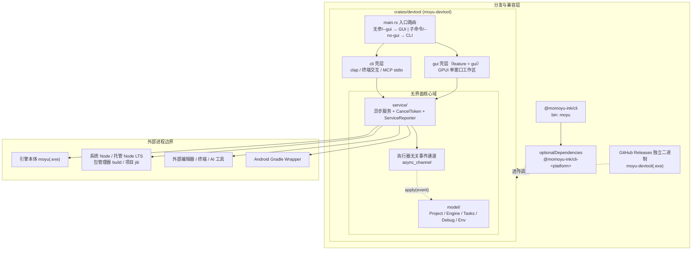

# RFC：基于 Rust 的统一开发工具链（`moyu-devtool`）

- **状态**：已定稿
- **日期**：2026-11-26（修订于 2026-11-28）
- **作者**：末语项目组
- **适用范围**：`crates/devtool`、`packages/cli`（`@momoyu-ink/cli` 及平台分包）、`scripts/release/`、`.github/workflows/`
- **相关 RFC**：[运行时调试桥](./2026-09-25-runtime-debug-bridge.md)、[多分辨率资源](./2026-09-30-multi-res-assets.md)、[无窗口运行（headless）](./2026-10-22-headless-runtime.md)、[`moyu-devtool` 图形界面设计（GPUI）](./2026-11-27-devtool-gui.md)

## 1. 摘要

本 RFC 定义末语（Moyu）引擎统一开发工具 `moyu-devtool`（`crates/devtool`）的架构、模块边界、运行契约与分发规范。

`moyu-devtool` 以单一 Rust 二进制同时提供 **GUI 与 CLI 双模式**（无参数或 `--gui` 启动 GPUI 桌面工作区；传入子命令或 `--no-gui` 进入命令行模式），替代原纯 Node.js 实现的 `@momoyu-ink/cli` 核心逻辑。对于前端构建与 Zod/TypeScript 运行时求值，工具链保留明确的 Node.js 外部边界，并通过 `@momoyu-ink/cli` 与分平台 npm 包提供向后兼容的命令入口。

## 2. 背景与动机

原 `@momoyu-ink/cli` 完全运行在 Node.js 之上，承担引擎下载与版本切换、多分辨率资产检查、本地运行与反向代理、调试桥与 MCP 服务、游戏打包（含 Android 与视频解码插件）以及 Zod JSON Schema 生成。该形态存在三类结构性限制：

1. **缺少图形化工作区**：下载进度、多版本管理、配置编辑、打包导出与实时节点树调试全部依赖命令行参数，对非命令行向创作者门槛偏高。
2. **基础能力强绑定 Node 生态**：引擎 `.tar.zst` 解压、静态文件服务、ZIP64 归档与 WebSocket 调试桥本身不依赖 JS 运行时，却必须依赖完整的 npm 依赖树。
3. **跨平台分发与运行时性能**：大体积游戏资产打包与多平台独立分发在原生 Rust 二进制下更可控，并可直接复用引擎仓库已有的 `tokio`、`serde_json`、`zip`、`zstd` 等基础设施。

## 3. 目标与非目标

### 目标

- 在单一 crate `crates/devtool` 中产出 `moyu-devtool`（与引擎本体 `moyu` 命名隔离），通过 Cargo `gui` feature（默认开启）同时支持完整桌面版与纯 CLI 构建。
- 以**数据模型与界面分离**的架构组织内部模块，使 CLI 与 GPUI 共用同一套领域模型与异步服务。
- 完整兼容既有 `@momoyu-ink/cli` 子命令语义、`.moyu/` 目录约定及 `index.json` / `moyu.json` / `framework.json` 工程配置格式。
- 建立独立于引擎本体的开发工具版本与发布轨道（`devtool-v*`），通过 `@momoyu-ink/cli` 平台分包与 GitHub Releases 同步分发。

### 非目标

- **不在 Rust 内实现 TypeScript / Zod 运行时求值**：`schema`、`ui-schema` 与工程前端构建继续交由外部 Node.js 执行。
- **不修改引擎侧调试协议**：沿用 [运行时调试桥](./2026-09-25-runtime-debug-bridge.md) 定义的 `engine:*` WebSocket 协议。
- **不对系统 Node.js 做硬性最低版本拦截**：仅探测可执行路径与版本号供展示和提示，避免随 Node 周期频繁改动工具链。

## 4. 总体架构



## 5. 核心规范

### 5.1 单 Crate 模块边界

全部代码位于 `crates/devtool/`，通过模块边界隔离职责而不拆分独立 core crate：

```text
crates/devtool/
├── assets/               # 应用图标与内嵌 Lucide SVG 图标
└── src/
    ├── main.rs           # 模式路由（GUI / CLI）与 Windows 控制台按需附着
    ├── config.rs         # 全局配置（~/.moyu/devtool.json）与路径约定
    ├── model/            # 纯数据领域模型与同步归约（无 tokio / GUI 依赖）
    │   ├── mod.rs        # DomainModel trait
    │   ├── project.rs    # ProjectModel（工程摘要与多分辨率检查报告）
    │   ├── engine.rs     # EngineModel（CDN 清单与本地 meta.json）
    │   ├── tasks.rs      # TasksModel（异步任务进度与日志缓冲）
    │   ├── debug.rs      # DebugModel（会话状态、节点树、引擎日志）
    │   └── env.rs        # EnvModel（Node、包管理器、jiti 探测结果）
    ├── service/          # 运行在 tokio 上的异步业务服务
    │   ├── mod.rs        # CancelToken、ServiceReporter、流式校验下载
    │   ├── project.rs    # 工程定位、配置读写、多分辨率资产检查
    │   ├── engine.rs     # CDN versions.json、.tar.zst 解压与版本切换
    │   ├── server.rs     # 分层静态服、COOP/COEP、127.0.0.1:6020 HTTP/WS 代理
    │   ├── run.rs        # 原生引擎与 Web 预览运行
    │   ├── debug.rs      # DebugSession WS 宿主机、进程/页面拉起与生命周期回收
    │   ├── mcp.rs        # stdio JSON-RPC 2.0 MCP 服务（11 个工具）
    │   ├── pack.rs       # 桌面/Web/Android/Framework 打包与 ZIP64 归档
    │   ├── video_decoder.rs # 视频解码插件下载校验与缓存
    │   ├── android.rs    # Android 工程同步、签名与 Gradle 调度
    │   ├── node.rs       # Node/PM/jiti 探测、Corepack 自动启用、install/build、Schema、托管 Node
    │   ├── editor.rs     # 跨平台编辑器 / 终端 / AI 工具探测启动、文件管理器与浏览器打开
    │   └── init.rs       # 拉取 DeepSpaceMill/framework 最新 main.zip 并自动装依赖与最新引擎
    ├── cli/              # CLI 壳层（clap、隐藏密码输入、终端输出、MCP stdio）
    └── gui/              # GPUI 图形界面壳层（受 `gui` feature 控制）
```

**强约束**：

- `model/` 仅依赖基础数据结构与 `serde`，禁止依赖 `tokio` 任务句柄、网络 I/O 或任何 GUI 类型。
- `service/` 禁止直接读写终端标准流；进度、阶段与日志统一通过 `ServiceReporter` 发送事件，由 CLI 或 GUI 壳层消费。

### 5.2 入口路由与 Windows 子系统

1. **模式判定**：
   - 显式传入 `--no-gui` 或任意已知子命令（`init`、`download`、`update`、`switch`、`run`、`debug`、`mcp`、`pack`、`schema`、`ui-schema`、`--help`、`--version`）进入 **CLI 模式**。
   - 无参数或显式传入 `--gui`（且未附带子命令）进入 **GUI 模式**；若以 `--no-default-features` 编译，GUI 入口提示重新启用 `gui` feature 并返回非零退出码。
2. **Windows 控制台行为**：
   - Release 构建启用 `#![cfg_attr(all(not(debug_assertions), target_os = "windows"), windows_subsystem = "windows")]`，双击启动 GUI 不弹控制台黑窗；所有后台控制台子进程（Node / 包管理器探测与执行、Gradle、调试引擎拉起等）统一设置 `CREATE_NO_WINDOW`（`0x0800_0000`），避免 Release 下闪烁临时黑框。
   - 仅进入 CLI 模式时按需调用 `AttachConsole(ATTACH_PARENT_PROCESS)`；GUI 模式禁止附着父终端。
   - 经管道调用（如 `moyu mcp` stdio JSON-RPC 或 `@momoyu-ink/cli` `spawn` 转发）时，标准输入输出句柄直接继承，退出码原样透传。

### 5.3 领域模型、事件通道与任务取消

- 所有领域模型实现统一纯同步归约接口：
  ```rust
  pub trait DomainModel {
      type Event;
      fn apply(&mut self, event: Self::Event) -> bool;
  }
  ```
- 长耗时服务接收 `ServiceReporter`（内置执行器无关 `async_channel::Sender<TaskEvent>` 与 `CancelToken`），支持分阶段进度汇报与协作取消，取消时自动清理未完成临时文件或终止子进程。
- **引擎子进程生命周期**：由 `service/debug.rs` 与 `service/run.rs` 拉起的原生引擎进程必须启用 `kill_on_drop(true)`；`DebugSession` 为 Native 子进程建立后台退出监听任务，游戏窗口自行关闭时自动关闭调试宿主机并发出 `DebugEvent::SessionStopped`；手动停止或 `Drop` 时发送终止信号并回收子进程、静态服与 WS 宿主机，避免遗留僵尸进程。

### 5.4 全局配置与工程配置写回

- **全局配置**（`~/.moyu/devtool.json`，`src/config.rs`）：持久化 `recentProjects`（最多 10 条）、`theme`（`system` / `light` / `dark` / `solarizedLight` / `oneDark`）、`locale`（`zhCn` / `enUs`）、`managedNodeVersion`、`preferredEditor`。
- **工程配置写回**（`service/project.rs::save_project_config`）：
  - 修改 `index.json` 的 `windowTitle`、`entryFilename`、`initialSurfaceSize`、`stageSize`（尺寸校验为 `<宽>x<高>` 正整数）及 `moyu.json` 的 `engine.channel`（文件不存在时自动创建）。
  - 读写以通用 JSON 对象合并方式进行，**严格保留配置文件中的其他无关字段**（如 `$schema`、`fontFile`、`steam`、`multiResAssets` 等）。

### 5.5 Node.js 边界、Schema 与托管 Node

- **环境探测**：优先探测本地托管目录 `~/.moyu/node/` 下的 `node`，未安装时回退至系统 `PATH`；同时探测项目 lockfile / `packageManager` 对应的包管理器（`yarn` / `pnpm` / `npm`）和项目 `jiti` 可用性。
- **Schema 生成（`schema` / `ui-schema` / `pack --framework`）**：通过探测到的 `node` 执行内嵌 ESM 脚本，**仅从项目及上层目录 `node_modules` 解析 `jiti`** 加载目标 `.ts` 文件并调用 Zod `.toJSONSchema({ io: 'input' })`；不做无 `jiti` 回退，缺失时直接报错提示安装项目依赖。
- **托管 Node LTS 与依赖安装**：支持从官方分发源拉取最新 LTS 便携归档、校验 `SHASUMS256.txt` 后解压至 `~/.moyu/node/<version>/`，并支持一键卸载清除 `~/.moyu/node/`；托管 Node 仅在子进程 `PATH` 前置注入，不污染系统全局环境变量。同时提供项目依赖安装服务（`run_project_install`），使用探测到的包管理器执行 `install`。
- **Corepack 自动启用**：当工程需要 `yarn` / `pnpm` 但当前不可用且存在 `corepack` 时，优先无权限直接执行 `corepack enable`（托管 Node 或用户可写目录无需提权）；若 Windows 系统 Node 目录受权限保护导致失败，通过原生 `ShellExecuteExW`（`runas`）临时申请 UAC 提权执行 `corepack enable`；用户取消或不可用时警告并回退至 `npm`。

### 5.6 外部工具探测与启动

`service/editor.rs` 以数据表（`LAUNCHERS`）统一描述跨平台外部工具，分为三类：

- **编辑器**：VS Code、VS Code Insiders、Cursor、Windsurf、Zed、WebStorm、Trae。
- **终端**：Windows Terminal、PowerShell 7、Windows PowerShell、Git Bash、WezTerm、Alacritty、macOS Terminal / iTerm2 / Warp / Ghostty、Linux GNOME Terminal / Konsole / Kitty。
- **AI 工具**：Antigravity、Codex App（macOS 经 `open -a`；Windows 通过用户注册表 `AppModel\Repository\Packages\OpenAI.Codex_*` 解析包根目录并调用内置 `app\resources\codex.exe app <dir>`）、Codex CLI（`codex`）、Claude Code（`claude`）、Gemini CLI（`gemini`）、OpenCode（`opencode`）、Pi（`pi`）、DeepSeek Harness（`dsh`）。
- **托管 Node 环境透传**：启动外部编辑器、终端与 AI 工具时，若本地存在托管 Node，动态在子进程 `PATH` 前置托管目录（不修改用户全局设置）；针对 Windows Terminal（MSIX 服务端会丢弃调用方 `PATH`），改在新建标签页的 Shell 初始化参数中注入 `$env:PATH`（使用 `[IO.Path]::PathSeparator` 避免 `;` 被 `wt.exe` 解析为子命令分隔符）。
- **文件管理器与浏览器**：提供 `open_in_file_manager`（Windows `explorer` / macOS `open` / Linux `xdg-open`）与 `open_url_in_browser`（Windows `rundll32 url.dll,FileProtocolHandler` / macOS `open` / Linux `xdg-open`）。

### 5.7 分发与三轨发布规范

- **npm 兼容层（`packages/cli`）**：`@momoyu-ink/cli` 为极薄转发包（`bin/moyu.js`，依赖仅保留 `jiti`），通过 `optionalDependencies` 关联 5 个平台包：
  - `@momoyu-ink/cli-win32-x64`、`@momoyu-ink/cli-linux-x64`、`@momoyu-ink/cli-linux-arm64`、`@momoyu-ink/cli-darwin-x64`、`@momoyu-ink/cli-darwin-arm64`。
- **独立版本与发布轨道**：仓库采用三轨独立版本与 tag 触发机制（由 `scripts/release/bump.mjs` 交互式 bump 并确认）：
  - 引擎本体：`v*`
  - 开发工具：`devtool-v*`（同步 `crates/devtool/Cargo.toml` 与 `packages/cli/package.json`，由 `.github/workflows/devtool-release.yml` 交叉编译 5 平台产物，发布 GitHub Release `--latest=false` 并通过 npm Trusted Publishing OIDC 发布主包与 5 个平台包）
  - React SDK：`kit-v*`（由 `.github/workflows/kit-release.yml` 通过 npm Trusted Publishing 发布 `@momoyu-ink/kit`）

## 6. CLI 行为契约

| 子命令 | 行为与契约 |
| :--- | :--- |
| `moyu init [name]` | 从 `DeepSpaceMill/framework` 下载最新 `main.zip` 解压并写入工程名；若无 Node 则自动安装托管 Node LTS，自动安装 `node_modules` 并下载激活当前渠道最新引擎（本机桌面 + Web），完成后可直接运行 |
| `moyu download` | 拉取 CDN `versions.json`（schema v2），流式下载 `.tar.zst`、校验 SHA-256 并更新 `.moyu/engine/meta.json` |
| `moyu update` | 在当前 channel 内增量更新已下载平台集合至最新版本 |
| `moyu switch` | 在本地已下载版本间切换 `active` 引擎 |
| `moyu run` | 执行多分辨率资产预检后拉起原生引擎（连接 `localhost:6020`）或启动带 `COOP`/`COEP` 与 `6020` 代理的分层静态服 |
| `moyu debug <subcmd>` | 启动 WS 调试宿主机，支持 `state` / `eval` / `logs` / `tree` / `props` / `screenshot` 及 `--web` / `--attach` / `--no-headless` |
| `moyu mcp` | stdio JSON-RPC 2.0 MCP 服务，暴露 11 个调试工具（`stdout` 仅输出协议帧，诊断写 `stderr`） |
| `moyu pack` | 编排工程构建、资源复制、ZIP64 归档、`--framework`、`--video-decoder` 与 Android 模板同步/隐藏签名密码输入/Gradle 构建 |
| `moyu schema` / `ui-schema` | 调起 Node + 项目 `jiti` 生成 `commands.schema.json` 与 `ui.schema.json` |

## 7. 权衡与已知限制

1. **`jiti` 依赖项目本地安装**：缺失 `jiti` 时直接报错，不引入内置回退或实验性 TS 擦除逻辑，以保持 TypeScript/Zod 行为与项目自身版本一致。
2. **Windows `windows_subsystem = "windows"` 终端行为**：直接从 `cmd.exe` 手动执行 `moyu-devtool.exe` 时外壳默认不阻塞等待；经 `@momoyu-ink/cli`（`moyu`）或 MCP 客户端调用则正常阻塞并透传 stdio。
3. **二进制体积权衡**：默认开启 `gui` feature 使单二进制体积增至约 15–25 MB，但换取零 WebView/Electron 运行时依赖与全平台一致体验；纯无头构建可通过 `--no-default-features` 获得轻量 CLI 产物。
